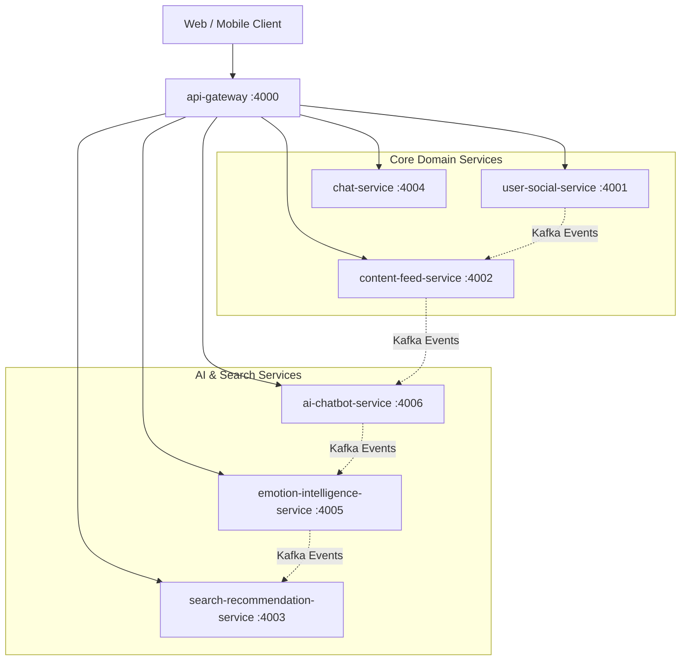

# SE121 Microservices Blueprint

👉 **Frontend Repository:** [social-network-2.0](../social-network-2.0/README.md)

## System Overview
Enterprise microservices platform for social, recommendation, chatbot, media, and AI-assisted user experiences, consolidated into 7 core services. The system features event-driven communication via Apache Kafka, high-performance distributed caching via Redis, asynchronous task queuing via RabbitMQ, full-text and semantic discovery through Elasticsearch and PostgreSQL pgvector, and multimodal AI analysis with RAG mental health assistance via FastAPI.

## Local Interface & Invariants
- `fushion.puml`: High-level system architecture and event flow PlantUML diagram.
- `docker-compose.yml`: Multi-container infrastructure orchestration definition (Kafka, Zookeeper, Redis, PostgreSQL, MongoDB, Elasticsearch, Kibana, RabbitMQ, Prometheus, Grafana).

## Subdirectories & System Boundaries
- [apps](./apps/README.md) - Core microservices and API gateway platform.
  - [api-gateway](./apps/api-gateway/README.md): Ingress reverse proxy (`:4000`), Clerk auth, Svix webhooks, and Socket.IO chat/presence namespace.
  - [ai-chatbot-service](./apps/ai-chatbot-service/README.md): FastAPI service (`:4006`) hosting PhoBERT/CLIP multimodal emotion, moderation, and RAG assistant.
  - [chat-service](./apps/chat-service/README.md): NestJS TCP service (`:4004`) for 1-on-1 and group messaging, presence, and Stream video calls.
  - [content-feed-service](./apps/content-feed-service/README.md): NestJS TCP service (`:4002`) for posts, comments, reactions, personalized Redis ZSET feed ranking, Cloudinary media, and RabbitMQ notifications.
  - [emotion-intelligence-service](./apps/emotion-intelligence-service/README.md): NestJS TCP service (`:4005`) for longitudinal emotion profiles, wellbeing dashboards, and proactive sweeps.
  - [search-recommendation-service](./apps/search-recommendation-service/README.md): NestJS TCP service (`:4003`) for Elasticsearch search, pgvector profile embeddings, and music recommendations.
  - [user-social-service](./apps/user-social-service/README.md): NestJS TCP service (`:4001`) managing identities, Clerk sync, relationship graphs, and groups in PostgreSQL (Drizzle ORM).
- [packages](./packages/README.md) - Reusable infrastructure libraries and DTO contracts.
  - [common](./packages/common/README.md): Shared Kafka, Redis, RabbitMQ, RPC exception filter, and OpenTelemetry modules.
  - [dtos](./packages/dtos/README.md): Centralized DTOs, request/response models, and validation enums.
  - [eslint-config](./packages/eslint-config/README.md): Monorepo ESLint configurations.
  - [typescript-config](./packages/typescript-config/README.md): Base TypeScript compilation options.
- [infrastructure](./infrastructure/README.md) - Telemetry and observability stack (Grafana dashboards, Prometheus scrape configs, Promtail).
- [evaluation](./evaluation/README.md) - Machine learning evaluation pipelines, emotion/moderation benchmarks, and MERT audio feature models.
- [seed-data](./seed-data/README.md) - Database population scripts, Clerk mock profiles, and synthetic test datasets.
- [tools](./tools/README.md) - Developer simulation tools and Clerk batch account creation scripts.

## Global Invariants
- External HTTP and WebSocket clients must enter exclusively via `api-gateway` (`:4000`); downstream microservices communicate via internal TCP or Kafka message channels.
- Inter-service asynchronous communication must use transactional outbox tables to guarantee at-least-once delivery to Apache Kafka.
- Microservice DTO contracts and enumerations must be defined in `@repo/dtos` to prevent payload drift.
- Shared infrastructure components (Redis, Kafka producers) must be injected via `@repo/common`.

## Global Side Effects
- Reads and mutates data across MongoDB (posts, chats, emotions), PostgreSQL (users, groups, recommendations), and Elasticsearch (search indexes).
- Emits and consumes high-throughput domain events over Apache Kafka topics.
- Dispatches asynchronous background notifications via RabbitMQ task queues.
- Synchronizes with external third-party services: Clerk (identity), Cloudinary (media storage), Stream (audio/video calling), and Groq (LLM inference).

## System Verification
- Run: `npm run check-types`
- Run: `npm run lint`
- Run: `turbo run test`

---

## 📐 Architecture Documentation

For a comprehensive technical overview of the system architecture, including service landscape, communication patterns, data flows, scalability considerations, and deployment architecture, see:

**→ [docs/architecture/architecture.md](docs/architecture/architecture.md)**

This document is suitable for technical interviews, portfolio presentations, and system design discussions.

### Architecture Notes

- The repository includes both standard NestJS services and specialized AI / assistant services.
- The main service boundaries are documented per app; this root README only captures the monorepo-level view.
- OpenAPI is currently published for the assistant gateway flow only.
- Observability is tool-driven at the infrastructure level; centralized tracing and metrics are configured but not fully enabled.

## Tech Stack

| Layer                    | Observed stack                     | Notes                                                                                                               |
| ------------------------ | ---------------------------------- | ------------------------------------------------------------------------------------------------------------------- |
| Runtime                  | Node.js 18+, Python 3.10+          | Root workspace engine constraint in `package.json` and AI requirements.                                             |
| Backend                  | NestJS 11.x                        | Primary framework for Node.js services.                                                                             |
| AI / Python              | FastAPI / Python                   | `ai-chatbot-service` hosts AI analysis and LLM RAG chatbot assistant workloads.                                     |
| Database: Relational     | PostgreSQL (Drizzle ORM, pgvector) | Primary storage for users, relationships, groups, and semantic vector embeddings.                                  |
| Database: Document       | MongoDB (Mongoose)                 | Primary storage for posts, comments, reactions, feeds, chat messages, and emotions.                                 |
| Database: Search         | Elasticsearch                      | Full-text multi-entity search and RAG knowledge retrieval.                                                          |
| Cache / Real-time        | Redis                              | Socket.IO state adapter, user presence, session memory, and feed ZSET ranking.                                     |
| Event Streaming          | Apache Kafka                       | Asynchronous domain event backbone with transactional outbox publishers.                                            |
| Task Queue               | RabbitMQ                           | Asynchronous notification dispatch and fan-out workers.                                                             |
| Observability            | Prometheus, Grafana, Loki          | Monorepo metrics, log shipping, and dashboard visualization.                                                        |

---

## Microservice Catalog

| Service | Port | Description | README |
| --- | --- | --- | --- |
| **api-gateway** | 4000 | HTTP/WebSocket entry point and routing gateway | [apps/api-gateway/README.md](apps/api-gateway/README.md) |
| **user-social-service** | 4001 | User profiles, social relation graph, and groups (PostgreSQL) | [apps/user-social-service/README.md](apps/user-social-service/README.md) |
| **content-feed-service** | 4002 | Posts, comments, feeds, media, notifications, and logs (MongoDB) | [apps/content-feed-service/README.md](apps/content-feed-service/README.md) |
| **search-recommendation-service** | 4003 | Elasticsearch search, semantic recommendations, and music catalog | [apps/search-recommendation-service/README.md](apps/search-recommendation-service/README.md) |
| **chat-service** | 4004 | 1-on-1 and group chats, audio/video calling, and outbox delivery | [apps/chat-service/README.md](apps/chat-service/README.md) |
| **emotion-intelligence-service** | 4005 | Emotion snapshots, history, analysis dashboard, and risk scoring | [apps/emotion-intelligence-service/README.md](apps/emotion-intelligence-service/README.md) |
| **ai-chatbot-service** | 4006 | FastAPI emotion analysis (text + images) & LLM RAG chatbot assistant | [apps/ai-chatbot-service/README.md](apps/ai-chatbot-service/README.md) |

## Shared Packages

| Package | Role | README |
| --- | --- | --- |
| `@repo/common` | Cross-service transport, caching, and infrastructure helpers | [packages/common/README.md](packages/common/README.md) |
| `@repo/dtos` | Shared DTO and contract definitions | [packages/dtos/README.md](packages/dtos/README.md) |
| `@repo/eslint-config` | Shared lint policy | [packages/eslint-config/README.md](packages/eslint-config/README.md) |
| `@repo/typescript-config` | Shared TypeScript compiler baselines | [packages/typescript-config/README.md](packages/typescript-config/README.md) |

## Local Development Setup

### Prerequisites

- Node.js 18 or newer
- npm 10.9.2 or newer
- Docker and Docker Compose
- Python 3.10+ (for `ai-chatbot-service`)

### Common Commands

| Command | Purpose |
| --- | --- |
| `npm install` | Install workspace dependencies. |
| `docker-compose up -d` | Start local infrastructure (Kafka, Redis, RabbitMQ, Elasticsearch, Kibana). |
| `npm run start:dev` | Start all 7 services in development mode in parallel. |
| `npm run build` | Build all workspace projects. |
| `npm run lint` | Run lint across the workspace. |
| `npm run check-types` | Run TypeScript checks across the workspace. |

## Observability Stack

The repository exposes several local observability and operations tools through Docker Compose.

| Tool | Port | Purpose | Status |
| --- | --- | --- | --- |
| **Grafana** | 3000 | Metrics, tracing & log dashboard | Available |
| **Prometheus** | 9090 | Time-series metrics collection | Available |
| **Jaeger** | 16686 | Distributed request tracing (OTLP receiver on 4317) | Available |
| **Loki** | 3100 | Log aggregation backend | Available |
| **Promtail** | — | Container log shipper to Loki | Available |
| **RabbitMQ Management UI** | 15672 | Queue and exchange inspection | Available |
| **Kafka UI** | 8080 | Topic and consumer group inspection | Configured |
| **Kibana** | 5601 | Elasticsearch log and document visualization | Configured |
