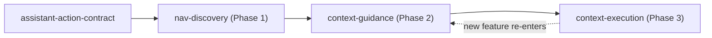

# Capability Map: In-App AI Assistant (Navigator → Guide → Doer)

> Status: **Approved 2026-10-31** (Phase 0). Decisions: Phase 3 executes via FE after user confirm; Phase 2 uses read-only gateway tools with user identity; Web first, shared types in `packages/shared`.
> Why a map: the request bundles 3 independently shippable/testable capabilities with different trust levels, data access and risk profiles. One monolithic spec would force every task to reason over execution-level risk.

## Current state (grounding)

- `AssistantRespondData.suggestedActions` already exists in [schemas.py](file:///home/vinh-co/projects/SE121-microservices/apps/ai-chatbot-service/app/modules/chatbot/schemas.py) but is **always `[]`** — a natural hook for Phase 1.
- `AssistantRespondRequest.contexts` exists (type/id/content) — the hook for Phase 2 surface context.
- Assistant today: RAG Q&A (mental health + app help docs) + guardrails. No navigation, no user-data tools, no write actions.
- Web routes available as navigation targets: `/friends/*`, `/groups/*`, `/conversations`, `/emotions`, `/notifications`, `/search`, `/settings/{privacy,notification-settings,activity,moderation-history,support}`, `/profile/[userId]`, …

## Mapping the strategy to Sentimeta's actual features

Derived from the real api-gateway controllers (`social`, `groups/*`, `posts`, `shares`, `comments`, `reactions`, `chats`, `notifications`, `emotions`, `moderations`, `search`, `musics`, `users`, `logs`) and web routes. "Fund movement" in the strategy = **write actions on the user's behalf**.

### Feature catalog by phase

| Feature area | Phase 1 – Navigate (no data) | Phase 2 – Guide (read-only, user-scoped) | Phase 3 – Execute (confirm required) |
|---|---|---|---|
| Friends / social graph | `/friends`, `/friends/requests`, `/friends/suggestions`, `/friends/blocked` | Pending requests (`GET social/requests`), friend suggestions (`friends/recommend`), relationship with X (`relationship/:id`) | Send/cancel/accept/decline request, dismiss suggestion · *Tier B:* unfriend, block/unblock |
| Groups | `/groups/explore`, `/groups/my-groups`, `/groups/invites`, `/groups/[id]` | My groups, group recommendations, invited groups, group info/settings | Send join request, accept/decline invite · *Tier B:* leave group |
| Posts / shares / comments | `/posts/[id]`, `/profile/[id]`, `/search` | My posts, edit history, why a post was moderated | **Pre-fill** post/comment draft (user edits & publishes) · *Tier B:* delete own post |
| Chat | `/conversations`, `/conversations/[id]` | Unread conversations | Open/create 1-1 conversation with X · hide/unhide conversation |
| Notifications | `/notifications`, `/settings/notification-settings` | Unread count, current preferences | Mark all read, update notification preferences |
| Emotions / wellbeing | `/emotions`, `/emotions/[id]` | Summary, trend, distribution, insights, intervention history | Submit emotion feedback · open music recommendations |
| Moderation | `/settings/moderation-history` | My moderation records & status | Pre-fill appeal (`POST moderations/appeals`) |
| Privacy / account | `/settings/privacy`, `/settings/activity`, `/settings/support` | Current privacy settings, activity log | Update privacy fields (`PATCH users`) |
| Music | music recommendation surface | Recommended tracks from emotion | — (read only) |

### Risk tiers for Phase 3

- **Tier A – reversible, low impact**: friend request send/cancel/accept/decline, join request, invite accept/decline, mark notifications read, preference/privacy toggles, hide conversation, emotion feedback. → Single confirm card.
- **Tier B – destructive or socially visible**: unfriend, block, leave group, delete own post, publish post/comment. → Confirm card showing exact effect + target; publishing is always **pre-fill only**, user presses the native "Đăng" button.
- **Excluded (never via assistant)**: all `admin/*`, `users/admin/*`, group moderation (ban/kick/change-role), account deletion (`DELETE users/:id`), sending chat messages as the user, reactions on behalf of the user, call actions.

## Modules

| Module id | Strategy phase | Responsibility | Depends on |
|---|---|---|---|
| `assistant-action-contract` | foundation | Typed action protocol shared BE↔FE: `navigate`, `show_card`, `propose_action`, `action_result`. Lives in `ai-chatbot-service` schemas + `@repo/dtos` + `packages/shared/src/types` | — |
| `nav-discovery` | Phase 1 | Route/destination catalog (id, path, params, VN/EN synonyms, required role); intent → `navigate` action; multi-step "how do I…" walkthroughs; **no user-data access**; intent telemetry (high-volume signal) | `assistant-action-contract` |
| `context-guidance` | Phase 2 | FE sends current **surface** (page + entity id); read-only, per-user-scoped data tools (e.g. pending friend requests, group info, privacy settings, emotion summary) via api-gateway/internal RPC; personalized answers in place. **No writes** | `nav-discovery` |
| `context-execution` | Phase 3 | Action registry (allowlist per feature), `propose_action` → user confirm → execute with idempotency key, audit log, undo where possible. A feature becomes executable **only after** it ships in `context-guidance` | `context-guidance` |

Build order: `assistant-action-contract` → `nav-discovery` → `context-guidance` → `context-execution` (each new executable feature re-enters at `context-guidance` first).

## Cross-cutting invariants (apply to every module)

- CrisisGuard still runs first; a crisis turn never returns navigation/execution actions except crisis resources.
- Mental-health non-diagnosis boundary unchanged.
- Chatbot service never holds write credentials of its own; authorization = the end user's identity forwarded by api-gateway.
- Every action is allowlisted server-side; the LLM can only pick from registry ids, never free-form URLs or endpoints.
