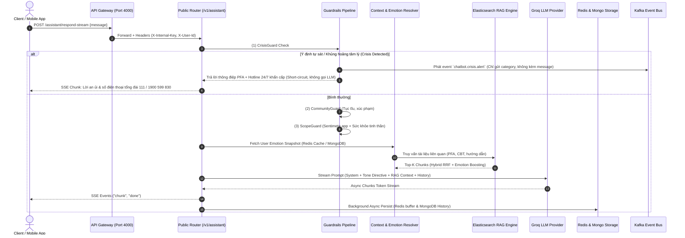

# Specification: Kiến Trúc & Thiết Kế AI Chatbot Service (`ai-chatbot-service`)

> **Trạng thái**: Đã phê duyệt (Phase 1: Specify Approved)  
> **Tài liệu tham chiếu**: [`AGENTS.md`](file:///home/vinh-co/projects/SE121-microservices/AGENTS.md), [`apps/ai-chatbot-service`](file:///home/vinh-co/projects/SE121-microservices/apps/ai-chatbot-service)

---

## 1. Giả định ban đầu (Assumptions Surfacing)

Trước khi đi vào đặc tả kỹ thuật chi tiết, các giả định cốt lõi sau đây đã được xác lập từ hiện trạng hệ thống:
1. **Mô hình triển khai**: `ai-chatbot-service` hiện là một **Modular Monolith** viết bằng Python FastAPI, kết hợp cả 2 mảng: (1) Phân tích cảm xúc/kiểm duyệt nội dung sự kiện (`analysis`) và (2) Trợ lý tâm lý hội thoại RAG (`chatbot`).
2. **Vai trò y tế & Pháp lý**: Chatbot đóng vai trò **Người bạn đồng hành & Sơ cứu tâm lý (PFA)**, tuyệt đối **KHÔNG** đóng vai trò bác sĩ tâm thần, không chẩn đoán hay kê đơn thuốc y khoa.
3. **Ranh giới Auth**: Không kết nối trực tiếp với Client ngoài Internet. Toàn bộ lưu lượng client đi qua API Gateway (`apps/api-gateway`), Gateway xác thực Clerk JWT và chuyển tiếp với header `X-Internal-Key` + `X-User-Id`.
4. **Mô hình ngôn ngữ**: Sử dụng Groq LLM API (Llama-3.3-70b / Llama-3.1-8b) cho phản hồi hội thoại và suy luận VLM; PhoBERT/MERT ONNX cục bộ cho phân tích nhúng, cảm xúc và kiểm duyệt.

---

## 2. Objective (Mục tiêu thiết kế)

Xây dựng và chuẩn hóa hệ thống trợ lý ảo thông minh tích hợp nhận thức cảm xúc (Emotion-Aware Conversational Assistant) cho mạng xã hội Sentimeta:
- **Người dùng mục tiêu**: Thành viên mạng xã hội cần hỗ trợ kỹ năng chăm sóc sức khỏe tinh thần, giải tỏa stress, sơ cứu tâm lý khẩn cấp (PFA), hoặc cần giải đáp cách dùng ứng dụng Sentimeta.
- **Giá trị mang lại**: 
  - Phát hiện và kích hoạt hotline khẩn cấp 24/7 khi người dùng có ý định tự hại / tự sát với độ trễ < 50ms.
  - Phản hồi đồng cảm, cá nhân hóa dựa trên lược sử cảm xúc gần nhất (Emotion Snapshot) của người dùng trên mạng xã hội.
  - Truy xuất chính xác kiến thức tâm lý (CBT, bài tập thở 4-7-8, Socratic questioning) qua Elasticsearch Hybrid RAG kèm trích dẫn nguồn minh bạch.

---

## 3. Tech Stack & Infrastructure

- **Framework**: Python 3.10+ / 3.12+, FastAPI, Uvicorn, Pydantic v2
- **LLM & Inference Orchestration**: LangChain, Groq API (`llama-3.3-70b-versatile`), ONNX Runtime (CPU quantized int8)
- **Cơ sở dữ liệu & Caching**:
  - **Redis 7 (`redis.asyncio`)**: Sliding-window session memory, facts tóm tắt, caching emotion snapshot (TTL 5 phút).
  - **MongoDB (Motor)**: Lưu trữ lịch sử hội thoại (`chat_conversations`, `chat_messages`), outbox events, aggregate cảm xúc.
  - **Elasticsearch 8.x / 9.x**: Tìm kiếm Hybrid RAG (Vector Dense Embeddings cosine similarity + BM25 Lexical + RRF Ranking).
- **Event Streaming**: Kafka (`aiokafka`) cho `chatbot.crisis.alert` và kết nối nghiệp vụ phân tích; RabbitMQ cho tác vụ nền.

---

## 4. Commands (Tập lệnh tiêu chuẩn)

```bash
# Cài đặt môi trường ảo & dependencies
cd apps/ai-chatbot-service
python3 -m venv .venv
.venv/bin/pip install -r requirements.txt

# Chạy server ở chế độ Development (Watch mode)
.venv/bin/uvicorn app.main:app --host 0.0.0.0 --port 4006 --reload

# Đánh chỉ mục tài liệu RAG vào Elasticsearch
INTERNAL_SERVICE_KEY=your_key .venv/bin/python -m app.tools.index_assistant_docs

# Linter và Formatter
.venv/bin/ruff check app/ tests/
.venv/bin/ruff format app/ tests/

# Chạy toàn bộ Unit & E2E Test Suite
INTERNAL_SERVICE_KEY=test GROQ_API_KEY=test .venv/bin/pytest tests/unit/ tests/e2e/ -v
```

---

## 5. Cấu trúc Project (Project Structure)

```
apps/ai-chatbot-service/
├── app/
│   ├── core/                           # Cấu hình hệ thống, bảo mật, kết nối DB nền tảng
│   │   ├── settings.py                 # Pydantic Settings đọc biến môi trường
│   │   ├── database.py                 # Async Motor MongoDB client
│   │   └── security.py                 # Xác thực X-Internal-Key (secrets.compare_digest)
│   ├── modules/
│   │   ├── chatbot/                    # [DOMAIN 1]: HỆ THỐNG TRỢ LÝ TÂM LÝ & RAG
│   │   │   ├── router.py               # Internal RPC REST Router (/assistant)
│   │   │   ├── public_router.py        # Gateway BFF Router (/v1/assistant)
│   │   │   ├── schemas.py              # Pydantic Request/Response DTOs
│   │   │   ├── services/
│   │   │   │   ├── assistant.py        # Orchestration layer (RespondCommand)
│   │   │   │   ├── guardrails.py       # CrisisGuard, ScopeGuard, CommunityGuard
│   │   │   │   ├── rag_engine.py       # Elasticsearch Hybrid Search & RRF ranking
│   │   │   │   ├── prompt_builder.py   # Emotion tone injection, PFA, Socratic directives
│   │   │   │   ├── memory.py           # Loop-aware async Redis session memory
│   │   │   │   └── emotion_context.py  # User emotion snapshot resolver
│   │   │   └── repositories/
│   │   │       └── chat_history.py     # MongoDB chat message persistence & write queue
│   │   └── analysis/                   # [DOMAIN 2]: MULTI-MODAL EMOTION & MODERATION
│   │       ├── services/ml_models/     # PhoBERT Emotion, PhoBERT Moderation, VLM
│   │       └── messaging/              # Kafka consumers/producers, Outbox, DLQ
│   └── tools/                          # Script offline: index RAG docs, load test
├── docs/assistant/                     # Knowledge Base: PFA, CBT, giáo trình, hướng dẫn app
└── tests/
    ├── unit/                           # Tests không phụ thuộc network ngoài (Mock LLM/DB)
    ├── integration/                    # Testcontainers (Redis, Kafka, Mongo)
    └── e2e/                            # Test luồng API Gateway -> Public Assistant Router
```

---

## 6. Luồng kiến trúc xử lý 1 lượt hội thoại (Architectural Flow)



---

## 7. Chuẩn mực phong cách mã nguồn (Code Style Guidelines)

- **Type Annotations**: Luôn áp dụng strict typing (`list[str]`, `dict[str, Any]`, `X | None`). Tránh dùng kiểu `Any` trừ khi deserialize schema đa hình.
- **Async Safety**: Tuyệt đối không dùng I/O đồng bộ trong async router/service. Mọi tương tác mạng với Redis, MongoDB, Elasticsearch phải được `await`.
- **Snippet ví dụ chuẩn**:
```python
class CrisisGuard:
    """Phát hiện tín hiệu khủng hoảng tâm lý với regex biên độ cao."""
    
    def evaluate(self, text: str) -> CrisisDecision:
        normalized = normalize_for_guard(text)
        if not normalized:
            return CrisisDecision(is_crisis=False, severity="none", reason="empty", normalized_text="")
            
        if _CRISIS_EXPLICIT_REGEX.search(normalized):
            return CrisisDecision(is_crisis=True, severity="high", reason="explicit_crisis", normalized_text=normalized)
            
        return CrisisDecision(is_crisis=False, severity="none", reason="clean", normalized_text=normalized)
```

---

## 8. Chiến lược kiểm thử (Testing Strategy)

1. **Unit Tests (`tests/unit/`)**:
   - Bắt buộc chạy cô lập, không gọi API Groq thật (dùng `FakeProvider`).
   - Mock Redis và MongoDB trong unit test để tốc độ thực thi toàn bộ suite < 5 giây.
2. **Integration Tests (`tests/integration/`)**:
   - Dùng `Testcontainers` (Redis, Kafka, MongoDB) để kiểm chứng tính bền vững của async connection pool, outbox retry worker và serialization.
3. **E2E Tests (`tests/e2e/`)**:
   - Kiểm tra hợp đồng API Public theo chuẩn `chatbot-api-contract.md` (định dạng SSE chunks, mã lỗi `UNAUTHENTICATED`, `FORBIDDEN`, `INVALID_REQUEST`).

---

## 9. Ranh giới vận hành (Boundaries & Quality Gates)

### Luôn luôn làm (Always):
- Chạy `CrisisGuard` trước bất kỳ bước xử lý nào khác để ngăn chặn rủi ro tự hại ngay lập tức.
- Giữ nguyên tắc **Data Minimization**: Tuyệt đối không nhét tin nhắn chat thô của người dùng vào Kafka alert payload gửi tới các service khác.
- Kiểm tra tính hợp lệ và timeout (< 2s) đối với các lệnh gọi Elasticsearch RAG và Redis.
- Luôn kiểm tra `secrets.compare_digest` khi xác thực internal key.

### Cần hỏi ý kiến trước (Ask First):
- Thay đổi mô hình LLM chính (ví dụ từ `llama-3.3-70b-versatile` sang Claude/OpenAI).
- Thay đổi cấu trúc trọng số cảm xúc (`emotion_boost` multipliers) trong RAG ranking.
- Bổ sung trường dữ liệu mới vào collection MongoDB `chat_messages` hoặc thay đổi Kafka event topics.

### Tuyệt đối không làm (Never):
- **Không chẩn đoán y khoa**: Không bao giờ để prompt khẳng định người dùng bị bệnh tâm thần hoặc kê tên thuốc.
- **Không chạy Sync I/O**: Không import client `redis.Redis` đồng bộ hoặc thư viện chặn luồng main thread.
- **Không rò rỉ prompt**: Không xuất system prompt, secret keys, hoặc tokens nội bộ ra câu trả lời cho client.
- **Không nuốt lỗi âm thầm**: Khi lưu lịch sử chat thất bại, phải có fallback ghi trực tiếp hoặc ghi log lỗi có cảnh báo, không drop lặng lẽ.

---

## 10. Tiêu chuẩn thành công (Success Criteria)

1. **Thời gian phản hồi (Latency)**:
   - Thời gian kích hoạt Crisis Guard (Short-circuit): **< 50ms**.
   - Thời gian Time-To-First-Token (TTFT) khi streaming SSE qua Groq API: **< 600ms**.
2. **Độ ổn định (Resilience)**:
   - Event Loop không bị nghẽn (Zero sync blocking I/O); đáp ứng tối thiểu 100 concurrent chat streaming sessions trên 1 instance uvicorn.
   - Khi Redis hoặc MongoDB tạm thời mất kết nối, hệ thống vẫn duy trì fallback thông minh trong RAM thay vì crash service.
3. **Chất lượng kiểm thử & Linting**:
   - Tỷ lệ pass test suite: **100%** (108/108 bài test hiện có).
   - Ruff lint errors: **0**.

---

## 11. Các câu hỏi mở cần thảo luận (Open Questions)

1. **Ranh giới dịch vụ (Service Boundary)**:
   - Hiện tại `analysis` (phân tích sự kiện post/ảnh/nhạc) và `chatbot` (trợ lý tâm lý RAG) đang cùng nằm chung trong `ai-chatbot-service`. 
   - *Câu hỏi*: Trong tương lai có nên tách `analysis` thành service riêng (`analysis-service`) để chatbot hoàn toàn độc lập và nhẹ tải hơn không?
2. **Bộ nhớ hội thoại dài hạn (Long-term Memory)**:
   - Hiện chatbot dùng Redis cho bộ nhớ gần (sliding window 16 lượt) và MongoDB lưu trữ phẳng. 
   - *Câu hỏi*: Có cần thiết kế thêm module Memory Consolidation (tóm tắt định kỳ tính cách, sở thích, chủ đề quan tâm của user lưu vào vector store) để chatbot nhớ người dùng qua nhiều tháng không?
3. **Chiến lược RAG Embedding**:
   - Hiện đang dùng script offline `index_assistant_docs.py` để sinh vector nhúng vào Elasticsearch.
   - *Câu hỏi*: Khi tài liệu hướng dẫn Sentimeta hoặc kiến thức PFA cập nhật mới, ta nên dùng trigger tự động qua API hay tiếp tục re-index định kỳ qua CI/CD?
