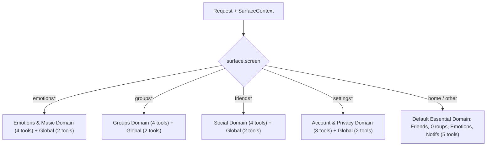

# SPEC-context-guidance: Phase 2 — Context-Aware Guidance

> **Version**: 1.1.0  
> **Status**: Approved  
> **Date**: 2026-10-31  
> **Author**: Sentimeta AI Core Engineering Team  
> **Dependencies**: [`SPEC-assistant-action-contract.md`](file:///home/vinh-co/projects/SE121-microservices/apps/ai-chatbot-service/SPEC-assistant-action-contract.md), [`CAPABILITY-MAP-in-app-assistant.md`](file:///home/vinh-co/projects/SE121-microservices/apps/ai-chatbot-service/CAPABILITY-MAP-in-app-assistant.md)

---

## 1. Overview & Objectives

In Phase 1 (Navigation & Discovery), the AI Assistant achieved zero-latency command short-circuiting and RAG how-to navigation suggestions across 20 allowlisted destinations.

**Phase 2 (Context-Aware Guidance)** elevates the assistant to a truly intelligent in-app companion by:
1. **Understanding where the user is (Surface Context)**: Ingesting the current application surface (`screen`, `entityId`, and `metadata`) so the assistant can answer contextual questions like *"Ai vừa đăng bài trong nhóm này?"* or *"Giải thích biểu đồ này giúp tôi"*.
2. **Accessing user-scoped, read-only personal data across domains**: Utilizing Groq Tool / Function Calling to securely retrieve the user's friend requests, group recommendations, unread notifications, recent post performance, 7-day emotional trends, and mood-based music recommendations.
3. **Dynamic Tool Routing**: Filtering available tool schemas based on the user's active screen to keep latency low (<1.5s) and eliminate LLM tool hallucination.
4. **Emitting Rich Mini Cards**: Supporting `type: "show_card"` alongside `type: "navigate"` to render structured widgets directly in chat.

### 🛡️ Core Security Invariants (Non-Negotiable)
- **CrisisGuard Precedence**: Crisis detection always executes *before* any tool execution or surface context injection. If distress/crisis is detected, all tool calls are aborted and emergency resources are returned immediately.
- **Strictly Read-Only (No Writes)**: Phase 2 is strictly read-only. No mutations (create, update, delete, send, join) are permissible in Phase 2.
- **Zero Direct Database Access**: Chatbot service never connects directly to other microservices' databases. It calls internal service endpoints forwarding the user's authenticated context (`userId` and `Authorization: Bearer <token>`).
- **Data Minimization**: Tool results returned to the LLM are stripped of PII (phone numbers, full emails, raw tokens, unneeded fields).

---

## 2. Surface Context Protocol

### 2.1 Request Schema Extension
Clients (Web & Native) send surface context in `AssistantRespondRequest`:

```python
class SurfaceContext(BaseModel):
    screen: str = Field(
        ...,
        description="Current client screen identifier (e.g., 'home', 'groups.detail', 'emotions', 'friends.requests')",
        pattern=r"^[a-z]+(\.[a-z_]+)*$"
    )
    entity_id: Optional[str] = Field(
        None,
        description="ID of the entity currently focused (e.g., groupId, postId, userId)",
        max_length=128
    )
    metadata: Optional[Dict[str, Any]] = Field(
        default_factory=dict,
        description="Lightweight screen metadata (e.g., activeTab, filterKey)"
    )

class AssistantRespondRequest(BaseModel):
    message: str = Field(..., min_length=1, max_length=2000)
    session_id: Optional[str] = None
    stream: bool = True
    surface: Optional[SurfaceContext] = None
    contexts: List[AssistantContextDTO] = Field(default_factory=list)
```

### 2.2 System Prompt Context Injection
The `PromptBuilder` formats active surface context into the system directive:

```text
[NGỮ CẢNH HIỆN TẠI CỦA NGƯỜI DÙNG]
- Màn hình đang mở: {surface.screen} ({screen_name_vi})
- Thực thể đang xem: {surface.entity_id or 'Không có'}
- Thông tin thêm: {surface.metadata or 'Không có'}
Chỉ sử dụng ngữ cảnh này khi người dùng hỏi các câu hỏi có đại từ mơ hồ ('ở đây', 'nhóm này', 'trang này').
```

---

## 3. Comprehensive Read-Only Tool Registry

Tools are partitioned into 5 functional domains:

### 3.1 Domain Tool Catalog

| Domain | Tool Name | Target Service | Purpose |
| :--- | :--- | :--- | :--- |
| **Social / Friends** | `get_my_friend_requests` | `user-social-service` | Lời mời kết bạn đang chờ duyệt |
| | `get_friend_recommendations` | `user-social-service` | Gợi ý bạn bè mới phù hợp |
| | `get_user_relationship` | `user-social-service` | Kiểm tra quan hệ bạn bè với user X |
| | `get_my_blocked_list` | `user-social-service` | Danh sách người dùng đang bị chặn |
| **Groups** | `get_group_context` | `group-service` | Thông tin chi tiết, quy tắc, admin của nhóm hiện tại |
| | `get_my_groups` | `group-service` | Danh sách các nhóm user đang tham gia |
| | `get_group_invitations` | `group-service` | Lời mời tham gia nhóm đang chờ duyệt |
| | `get_group_recommendations` | `group-service` | Nhóm gợi ý dựa trên sở thích |
| **Emotions & Music** | `get_my_emotion_summary` | `emotion-intelligence-service` | Báo cáo cảm xúc 7 ngày qua |
| | `get_my_emotion_trends` | `emotion-intelligence-service` | Xu hướng và biến động cảm xúc theo tuần/tháng |
| | `get_recommended_music_for_mood` | `music-service` | Gợi ý nhạc phù hợp theo tâm trạng hiện tại |
| | `get_mindfulness_exercises` | `emotion-intelligence-service` | Gợi ý bài tập thở/thư giãn theo cảm xúc |
| **Content & Feed** | `get_my_posts_overview` | `content-feed-service` | Thống kê bài viết và tương tác của tôi |
| | `get_post_comments_summary` | `content-feed-service` | Tóm tắt các ý kiến, bình luận của bài viết |
| | `get_my_saved_posts` | `content-feed-service` | Danh sách bài viết đã lưu |
| **Account & Safety** | `get_my_unread_notifications` | `notification-service` | Tóm tắt thông báo mới nhất chưa đọc |
| | `get_my_privacy_settings` | `user-social-service` | Cài đặt quyền riêng tư hiện tại |
| | `get_my_moderation_history` | `moderation-service` | Lịch sử kiểm duyệt bài viết/bình luận của tôi |

---

## 4. Dynamic Tool Routing by Surface Context

To prevent context bloat and ensure fast Groq inference (<1.5s first token), `ToolRouter` filters available tools dynamically:



- **Global Tools** (always included): `get_my_unread_notifications`, `get_my_emotion_summary`.
- Maximum tools active in any single LLM turn: **6 tools**.

---

## 5. Mini Cards Contract (`show_card`)

When a tool returns rich structured data, the assistant can emit a `show_card` action in `suggestedActions`:

```typescript
export interface AssistantCardAction {
  type: 'show_card';
  id: string;
  label: string;
  payload: {
    cardType:
      | 'emotion_summary'
      | 'friend_requests'
      | 'group_recommendations'
      | 'music_recommendations'
      | 'unread_notifications'
      | 'post_overview';
    data: Record<string, unknown>;
  };
}

export type AssistantSuggestedActionDTO = AssistantNavigateAction | AssistantCardAction;
```

---

## 6. Implementation Milestones

- **Slice 2.1**: Surface Context contract & prompt builder injection (BE + FE).
- **Slice 2.2**: Tool Registry & Dynamic Tool Router in `ai-chatbot-service`.
- **Slice 2.3**: Downstream service integrations with auth token forwarding & circuit breakers.
- **Slice 2.4**: `show_card` schema & UI Mini Cards (Web & Native).
- **Slice 2.5**: Integration tests, safety mutation tests & telemetry tracking.
