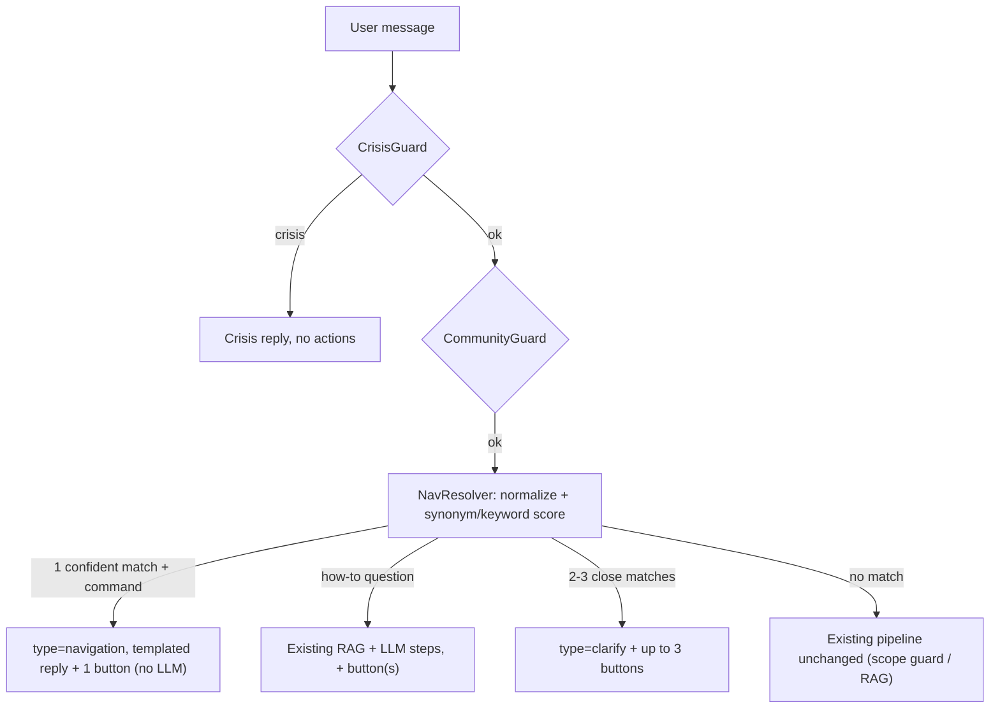

# Spec: `nav-discovery` (Strategy Phase 1 – The assistant as a navigator)

> Module of [CAPABILITY-MAP-in-app-assistant.md](./CAPABILITY-MAP-in-app-assistant.md) · Depends on: [`assistant-action-contract`](./SPEC-assistant-action-contract.md) · Status: **Draft – awaiting review**

## Assumptions

1. **No user-data access** in this module. Only static destinations plus destinations whose params come from the user's own words (e.g. search query). Entity pages (`/profile/[userId]`, `/groups/[groupId]`) are out of scope until `context-guidance`.
2. Destination resolution is **deterministic first** (normalized Vietnamese synonym matching, diacritics-insensitive). The LLM may write the explanation text but **never chooses or invents a destination**.
3. "Multi-step navigation" = a short step list grounded in the existing help docs (`docs/assistant/guide-*.md`) + a button to the final destination.
4. Admin routes (`/admin/*`) are never offered.

## Objective

Let a user reach any user-facing screen of Sentimeta in one prompt, e.g. "xem lời mời kết bạn", "tắt thông báo", "tìm nhóm yoga", "làm sao xem lịch sử kiểm duyệt". It also produces an intent signal (what users ask for vs. what they click) that tells us which features to build Phase 2 guidance for first.

**User stories**
- As a user, I type where I want to go and get a button that takes me there.
- As a user asking "how do I…", I get numbered steps **and** a button to the right screen.
- As a user with an ambiguous request ("cài đặt"), I get up to 3 candidate buttons instead of a guess.
- As the product team, we can see top requested destinations, unresolved intents and click-through rate.

## Destination Catalog (source of truth: BE, `app/modules/chatbot/navigation/destinations.yaml`)

Initial set (from the real web routes):

| destinationId | Route | Params |
|---|---|---|
| `home` | `/` | — |
| `friends`, `friends.requests`, `friends.suggestions`, `friends.blocked` | `/friends[/…]` | — |
| `groups.explore`, `groups.my_groups`, `groups.invites` | `/groups/…` | — |
| `conversations` | `/conversations` | — |
| `notifications` | `/notifications` | — |
| `emotions` | `/emotions` | — |
| `search` | `/search` | `q` (≤ 100 chars), `type` ∈ {posts, users, groups} |
| `profile.me` | `/profile/{currentUserId}` (FE fills id) | — |
| `settings`, `settings.privacy`, `settings.notifications`, `settings.activity`, `settings.moderation_history`, `settings.support`, `settings.privacy_policy` | `/settings/…` | — |

Each entry: `id`, `labelVi`, `synonyms[]`, `description`, `helpDocIds[]`, `params` schema. The FE mirror in `packages/shared/src/navigation/destinations.ts` maps id → route. A contract test makes the two id lists match exactly (see Open Question 1).

## Behaviour



- NavResolver runs **after** Crisis/Community guards and **before** ScopeGuard's out-of-scope rejection (navigation intents are in scope).
- Search extraction: "tìm nhóm yoga" → `search` with `{q:"yoga", type:"groups"}`; the query text passes through CommunityGuard first.
- The pure-navigation path skips the LLM: target **p95 < 150 ms** end-to-end in the service.

## Intent Telemetry

- BE records one event per turn where the resolver ran: `{userIdHash, destinationIdsOffered[], resolverPath (command|howto|clarify|none), normalizedIntentTokens, ts}`. **No raw message text** (same data-minimization rule as crisis alerts).
- FE reports button clicks: `{actionId, destinationId}`.
- Storage/transport: MongoDB `assistant_intent_events` (TTL 90 days); clicks arrive via `POST /assistant/actions/click` on api-gateway → ai-chatbot-service internal endpoint.

## Commands

Same as [`assistant-action-contract`](./SPEC-assistant-action-contract.md#commands), plus:
```bash
INTERNAL_SERVICE_KEY=test .venv/bin/pytest tests/unit/test_nav_resolver.py -v   # includes eval-set accuracy test
```

## Project Structure

```
apps/ai-chatbot-service/app/modules/chatbot/navigation/
  destinations.yaml        # catalog
  catalog.py               # load + validate catalog at startup (fail fast on bad entry)
  resolver.py              # NavResolver (pure, sync, no I/O)
  telemetry.py             # intent event writer
apps/ai-chatbot-service/app/modules/chatbot/services/assistant.py   # wire resolver into guard chain (execute + execute_stream)
apps/ai-chatbot-service/tests/unit/test_nav_resolver.py
apps/ai-chatbot-service/tests/fixtures/nav_eval_vi.jsonl            # ≥ 120 labelled utterances
social-network-2.0/packages/shared/src/navigation/destinations.ts
social-network-2.0/apps/web/components/chatbot/assistant-sheet.tsx  # buttons + click telemetry
```

## Code Style

```python
@dataclass(frozen=True, slots=True)
class NavMatch:
    destination_id: str
    score: float
    params: dict[str, str]

class NavResolver:
    def __init__(self, catalog: DestinationCatalog) -> None:
        self._catalog = catalog

    def resolve(self, text: str) -> list[NavMatch]:
        """Return ≤3 matches sorted by score; [] when nothing clears the threshold."""
        tokens = normalize_for_guard(text)
        ...
```

## Testing Strategy

- **Unit (resolver)**: table-driven cases per destination, diacritic-free input, search param extraction, admin phrases → no match, crisis phrase never reaches the resolver.
- **Eval-set test**: `nav_eval_vi.jsonl` (≥ 120 utterances, written by us + sampled from real anonymized history if allowed). Gate: **top-1 ≥ 85 %, top-3 ≥ 95 %, false-positive (non-nav message gets a button) ≤ 5 %**.
- **Assistant service unit**: navigation turn skips the LLM (FakeProvider not called); how-to turn calls the LLM and attaches buttons; crisis turn has no actions.
- **E2E**: stream first chunk contains the `navigate` action.
- **FE**: catalog contract test (ids equal to the BE yaml snapshot); manual click-through for every destination.

## Boundaries

- **Always**: run CrisisGuard first; keep the resolver pure and fast (< 5 ms); log telemetry without raw text.
- **Ask first**: adding destinations that need entity ids or user data; new Kafka topics; new gateway endpoints.
- **Never**: let the LLM produce destination ids/paths; offer admin routes; auto-navigate without a click (unless the Open Question decides otherwise).

## Success Criteria

1. Every catalog destination is reachable from at least 3 natural Vietnamese phrasings (covered in eval set).
2. Eval gates above pass in CI.
3. Pure-navigation turns: p95 < 150 ms in service, zero LLM calls.
4. Existing behaviour unchanged for non-navigation messages (all existing tests green).
5. Telemetry shows offered vs. clicked per destination for the first week after release.

## Open Questions

1. ~~Catalog duplication~~ **Resolved**: BE yaml is the source of truth; the FE TS map is kept in sync by a contract test. The BE never sends paths.
2. ~~Telemetry sink~~ **Resolved (a)**: MongoDB collection `assistant_intent_events` in ai-chatbot-service + new gateway endpoint `POST /assistant/actions/click` (guarded by `GatewayExceptionsFilter`, Clerk auth).
3. **Native**: pending decision (see conversation: defer vs. platform-aware map vs. deep-link scheme).
