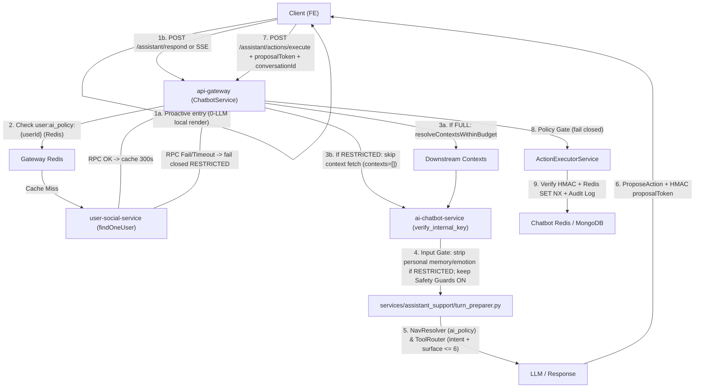

# AI Chatbot Hardening: Proactive Interrupt, 3 Pillars, and Policy Guard

* **Author:** coquach
* **Date:** 2026-11-15
* **Status:** Ready for Review

## Overview

This document specifies a targeted hardening refactor across `apps/ai-chatbot-service`, `apps/api-gateway` (chatbot module), and `packages/dtos` (`@repo/dtos`), along with the required client API contract changes. It addresses three production defects in the current chatbot pipeline:

1. **Proactive Interrupt & Tone Leakage:** The chatbot currently drops a user's opening message when a proactive check-in flag is active, forces therapy-style directives onto ordinary product questions, and runs a broken RabbitMQ consumer that risks overwriting longitudinal emotion risk metrics.
2. **Navigation, Tool Routing, and Action Execution:** Navigation offers bypass `aiPolicy` checks, tool routing ignores user intent outside the current screen, and write-action execution lacks proposal binding, multi-replica idempotency, a production mock guard, and an audit log.
3. **Fail-Open Policy Enforcement:** `api-gateway` falls back to `FULL` access and client-supplied policy values when `user-social-service` fails or times out, fetches personal context in parallel with policy resolution, and `ai-chatbot-service` does not block personal memory or emotion snapshots from entering the prompt when `aiPolicy` is `RESTRICTED`.

## The Problem

### 1. Dropped User Messages, Wrong Tone, and Unsafe Cache Writes
* When a user has an active `needs_proactive_checkin` flag and starts a new conversation, `ai-chatbot-service` replaces the user's actual message with a proactive check-in directive. Because `suggested_action` is never consumed, every new conversation within 24 hours repeats this override.
* When a user asks a general Sentimeta product question that does not match a predefined feature domain, the context resolver falls back to `emotion_snapshot` and injects CBT/PFA therapy directives into a normal Q&A turn.
* `ai-chatbot-service` runs a RabbitMQ consumer (`app/modules/analysis/rabbitmq.py`) bound to the wrong exchange and routing key (`proactive.intervention` / `notification.proactive` instead of `notification` / `proactive.intervention`). If its binding were fixed, its `update_cache()` call would overwrite `risk_score` and `stable_windows` in `emotion:longitudinal:{userId}`, breaking Single-Writer ownership held by `emotion-intelligence-service`.

### 2. Unsafe Navigation, Incomplete Tool Routing, and Single-Process Action Execution
* `NavResolver` only checks admin keywords and static path prefixes/tokens without checking `aiPolicy`.
* `ToolRouter` selects tools strictly from `surface.screen.startswith(...)`, so cross-domain user requests miss the tools needed to answer them.
* `ActionExecutorService` accepts `ActionExecutionRequest` without verifying that the action and parameters were actually proposed by the assistant for that user and conversation. It also relies on process-local `asyncio.Lock` and an in-memory fallback cache (`_local_cache`), which cannot prevent duplicate mutations across multiple replicas. Finally, write actions have no append-only audit trail, and `TOOL_ENABLE_MOCK_FALLBACKS` has no production guard.

### 3. Fail-Open Privacy Policy (`aiPolicy`)
* `api-gateway` resolves the user's `aiPolicy` via RPC to `user-social-service` in parallel with `resolveContextsWithinBudget`. If the RPC fails or times out, it falls back to client-supplied `dto.aiPolicy` or `"FULL"`, exposing personal context when the policy service is degraded.
* Inside `ai-chatbot-service`, setting `aiPolicy=RESTRICTED` does not stop `user_facts`, `memory_summary`, or `emotion_snapshot` from being included in prompts, `AssistantRespondRequest` / `ActionExecutionRequest` default `aiPolicy` to `"FULL"`, `fact_extractor` still schedules extraction, and policy enforcement relies on post-LLM keyword matching rather than input-time gating.

## Goals

1. **Preserve User Agency on Opening Turns:** Remove the implicit proactive interrupt and `app/modules/analysis/rabbitmq.py` from `ai-chatbot-service`. Render proactive check-ins on the client from `ProactiveInterventionDto` / `chatbotPromptContext` without calling `/respond` on load.
2. **Isolate Therapy Tone from Product Q&A:** Decouple `_is_mental_health_turn` and `_build_emotion_tone_directive` from defaulting to therapy tone on non-emotional queries, and suppress turn-level therapy tone on `is_system_turn` without erasing active distress continuity.
3. **Harden Navigation, Tool Routing, and Action Execution:**
   * Enforce `aiPolicy` (`policy_scope: "public" | "personal"`) in `NavResolver`.
   * Upgrade `ToolRouter` to combine intent-overlay tools from `scope_decision.matched_domains` with surface anchor tools, capped at `6` active tools, while keeping `"public"` tools available under `RESTRICTED`.
   * Bind `ProposeActionPayload` and `ActionExecutionRequest` with an HMAC-SHA256 `proposalToken` across `@repo/dtos`, `api-gateway`, `ai-chatbot-service`, and the client contract.
   * Replace process-local action idempotency with fail-closed Redis `SET NX`, block `TOOL_ENABLE_MOCK_FALLBACKS` in production, and record every write action in an append-only audit log.
4. **Enforce `aiPolicy` Fail-Closed:** Cache `user:ai_policy:{userId}` in `api-gateway` Redis (invalidated synchronously on `UsersController.update`), default to `RESTRICTED` on cache-miss + RPC failure (with a short circuit-breaker fallback on Redis/RPC errors), resolve policy before fetching personal context, default internal Pydantic `aiPolicy` fields to `"RESTRICTED"`, and gate dynamic emotion snapshots, cross-service personal tools, and state-mutating actions at input/routing time in `ai-chatbot-service` (while preserving baseline non-sensitive `user_facts`, background fact extraction, and safety guardrails).

## Non-Goals

* Modifying `content-feed-service` Safe Space interleaving or `NotificationController` proactive notification delivery.
* Modifying `emotion-intelligence-service` longitudinal risk scoring, `WarningService` hysteresis rules, or its ownership of `emotion:longitudinal:{userId}`.
* Splitting the single user-facing `aiPolicy` toggle (`FULL` | `RESTRICTED`) into multiple granular UI switches.

## Technical Plan

### Architecture & Request Flow

---

### 1. Proactive Interrupt & Tone Isolation

* **0-LLM Static Proactive Entry (Client Contract):**
  * When a user opens the assistant from a proactive notification or Safe Space card, the client renders the opening check-in locally from `ProactiveInterventionDto` / `chatbotPromptContext` without calling `POST /assistant/respond` on load. Dismissal/consumption of `needs_proactive_checkin` / `suggested_action` is handled by the notification/client flow outside `/respond`.
  * `ai-chatbot-service` removes `is_proactive_checkin` and `_build_proactive_checkin_directive` from `services/assistant_support/turn_preparer.py`, `prompt_builder.py`, `types.py`, and `services/assistant.py`, as well as `has_proactive_context` in `prompt_builder.py` and the `emotion_snapshot.needs_proactive_checkin` skip in the `GREETINGS` fast-path of `turn_preparer.py`. Every `/respond` call answers the user's actual `request.message`.
* **Remove Broken RabbitMQ Consumer:**
  * Delete `apps/ai-chatbot-service/app/modules/analysis/rabbitmq.py` and remove `init_rabbitmq` / `close_rabbitmq` calls from `apps/ai-chatbot-service/app/modules/analysis/lifespan.py`.
  * `emotion:longitudinal:{userId}` remains strictly read-only in `ai-chatbot-service`, preserving Single-Writer ownership in `emotion-intelligence-service`.
* **Decouple Therapy Tone from Non-Emotional Turns:**
  * In `context_resolver.py` (`_is_mental_health_turn`), remove the fallback branch that inspects `emotion_snapshot` whenever `matched_domains` does not intersect `SYSTEM_FEATURE_DOMAINS`. A turn is treated as a mental-health turn only if `distress_level in {"mild_cbt", "acute_pfa"}`, `has_in_chat_emotional_distress(query)` is true, or `matched_domains` intersects `{"mental_health", "emotion"}`.
  * Apply the same rule to `_build_emotion_tone_directive` in `prompt_builder.py` so normal Sentimeta product questions never receive CBT/PFA directives.
* **Turn-Level Tone Suppression & Conditional Session Emotional State Reset:**
  * In `services/assistant_support/turn_preparer.py`, compute `is_system_turn` before `has_active_session_anchor`. Suppress turn-level therapy directives whenever `is_system_turn` is true, and reset `session_emotional_state` (`{"active_tier": "NONE", "remaining_turns_ttl": 0, "topic_anchor": ""}`) only when `is_system_turn and distress_level == "none"` so prior emotional context does not leak into product Q&A while active distress continuity is preserved.

---

### 2. Navigation, 2-Tier Tool Routing, and Hardened Action Execution

* **Policy-Aware Navigation (`navigation/resolver.py`, `navigation/policy.py`, `navigation/catalog.py`, `navigation/destinations.yaml`):**
  * Add `policy_scope` (`"public"` | `"personal"`) metadata to destinations in `destinations.yaml` and parse it in `DestinationCatalog` (`navigation/catalog.py`).
  * Pass `ai_policy` into `NavResolver.resolve(...)` and `build_nav_outcome(...)`. Under `"RESTRICTED"`, filter out `"personal"` destinations while keeping `"public"` help, safety, and settings destinations available.
* **2-Tier Hybrid Tool Router (`tools/router.py`, `tools/catalog.py`):**
  * Replace surface-only routing with a 2-tier selection algorithm capped at `MAX_ACTIVE_TOOLS = 6`:
    1. **Tier 1 (Intent Overlay):** Map `scope_decision.matched_domains` to `DOMAIN_TOOLS` keys (`"mental_health"` / `"emotion"` -> `"emotions"`, `"group"` -> `"groups"`, `"user_social"` / `"social"` -> `"social"`, `"privacy"` / `"settings_support"` / `"auth"` -> `"account"`, `"post"` / `"search"` -> `"content"`; unmapped domains such as `"chat"`, `"call"`, `"notification"` fall through to Tier 2 / `GLOBAL_TOOLS`).
    2. **Tier 2 (Surface Anchor):** Append domain tools matching `surface.screen`, followed by `GLOBAL_TOOLS` (excluding `GET_MY_EMOTION_SUMMARY` when `is_system_turn` is true), falling back to `DEFAULT_ESSENTIAL_TOOLS` if both Tier 1 and Tier 2 are empty.
    3. Deduplicate preserving order and slice to `6`.
  * Segment tools in `tools/catalog.py` with `policy_scope` (`"public"` | `"personal"`): when `ai_policy == "RESTRICTED"`, return only `"public"` tools (never `"personal"` tools).
* **Signed Capability Token (`proposalToken`):**
  * Add `proposalToken: str` to `AssistantProposeActionPayloadDto` (`@repo/dtos`), `ProposeActionPayload`, and `ActionExecutionRequest` (`schemas.py`), and require both `proposalToken: string` and `conversationId: string` in `POST /assistant/actions/execute` (`chatbot.controller.ts`, `chatbot.service.ts`, `ActionExecutionRequest`).
  * **Token Format & Signing:** `proposalToken = "<expires_at_unix>.<hmac_hex>"`. `proposals.py` accepts `user_id` and `conversation_id`, generates `ProposeAction.id` (`actionId`) and `ProposeActionPayload.idempotencyKey` prior to signing, and computes the HMAC-SHA256 digest over the canonical string:
    `"{userId}|{conversationId}|{actionId}|{actionName}|{paramsHash}|{idempotencyKey}|{expiresAt}"`
    where `paramsHash` is the SHA-256 hex digest of `json.dumps(params, sort_keys=True, separators=(",", ":"))` (computed on normalized canonical params).
  * **SSE & TTL:** `services/assistant.py` (`execute_stream`) emits `proposals` on the post-tool SSE chunk regardless of `first_yield`. Default `expiresAt` is `now + 900` seconds (15 minutes), signed with `PROPOSAL_HMAC_KEY`.
  * **Verification & Error Mapping:** Missing, expired, or invalid tokens are rejected before execution with `PROPOSAL_TOKEN_INVALID` (HTTP `400`/`403`) or `PROPOSAL_TOKEN_EXPIRED` (HTTP `400`).
* **Distributed Redis Idempotency (Fail-Closed):**
  * Replace `chatbot:action_idempotency:{key}`, `_local_cache`, and `_inflight_locks` in `ActionExecutorService` (`actions/executor.py`) with Redis key `chatbot:action:idem:{userId}:{idempotencyKey}`:
    1. Check `GET`; if a completed serialized `ActionExecutionResponse` exists, return it immediately. If `{"status":"inflight",...}` exists, return `ACTION_IN_PROGRESS` (HTTP `409`).
    2. Acquire an in-flight lease with `SET key '{"status":"inflight","attemptId":"<uuid>"}' NX EX 30`. If `NX` fails, re-read `GET` to return the completed response (if just finished) or `ACTION_IN_PROGRESS` (HTTP `409`).
    3. On terminal outcomes (`result.success` or deterministic `4xx` denial), overwrite the key with the serialized `ActionExecutionResponse` (`EX 900`). On transient failure/exception, release the lease via an atomic Redis Lua compare-and-delete matching `attemptId` so retries are not blocked.
  * If Redis is unreachable or throws, **fail closed** with `ACTION_IDEMPOTENCY_UNAVAILABLE` (HTTP `503`) rather than executing without a shared lock.
* **Production Mock Guard:**
  * Add `APP_ENV: str = "development"` to `Settings` (`app/core/settings.py`) and enforce `if APP_ENV == "production" and TOOL_ENABLE_MOCK_FALLBACKS: raise RuntimeError(...)` in `Settings._validate()` (and reject runtime execution in `ActionExecutorService` with `MOCK_FALLBACK_FORBIDDEN_IN_PROD`, HTTP `500`, if `settings.APP_ENV == "production"` and `TOOL_ENABLE_MOCK_FALLBACKS` is enabled).
* **Append-Only Write-Action Audit Log:**
  * Insert an immutable record into MongoDB collection `chatbot_action_audit_logs` on every `/actions/execute` attempt (gated by `settings.CHATBOT_DB_ENABLED`, indexed on `(userId, createdAt)` with a retention TTL, and purged/anonymized on `user.removed` in `user_event_consumer.py`) with fields:
    `auditId`, `userId`, `conversationId`, `actionId`, `actionName`, `idempotencyKey`, `paramsHash`, `aiPolicy`, `status` (`"succeeded" | "denied" | "failed" | "replayed"`), `errorCode`, `latencyMs`, `createdAt`. Never log raw `authToken` or `proposalToken`. Audit writes use a bounded timeout and fail-open with structured stdout logging so a MongoDB blip does not block action responses.

---

### 3. Fail-Closed Policy Guard

* **Gateway Policy Cache & Fail-Closed Resolution (`apps/api-gateway`):**
  * Store `user:ai_policy:{userId}` in Gateway Redis (injected via `@InjectRedis()` from `@nestjs-modules/ioredis`) with a `300s` TTL (`"FULL"` or `"RESTRICTED"`).
  * In `ChatbotService.resolveUserAiPolicy(userId)`:
    1. Read `user:ai_policy:{userId}` from Redis. If present and valid (`FULL` | `RESTRICTED`), return it.
    2. On cache miss, call `user-social-service` (`findOneUser`, `1000ms` timeout). If RPC returns a valid `privacySettings.aiPolicy`, write it to Redis (`EX 300`) and return it.
    3. On Redis error, RPC error, timeout, or missing policy, **fail closed** and return `"RESTRICTED"` (using a short-TTL in-memory circuit-breaker fallback to avoid RPC stampedes during outages). Remove the `fallbackPolicy` parameter so client-supplied `dto.aiPolicy` is never trusted.
  * **Synchronous Cache Invalidation:**
    * In `UsersController.update` (`@Patch()` in `apps/api-gateway/src/modules/users/users.controller.ts`), `await lastValueFrom(this.client.send("updateUser", { id, updateUserDto }))` and immediately delete `user:ai_policy:{userId}` from Redis when `privacySettings` is included in the update.
* **Sequential Policy-Before-Context Fetch (`ChatbotService`):**
  * In both `respond()` and `respondStream()`, `await this.resolveUserAiPolicy(userId)` **before** `resolveContextsWithinBudget(...)`.
  * When `effectivePolicy === "RESTRICTED"`, skip `resolveContextsWithinBudget` completely and pass `contexts: []` to `ai-chatbot-service`.
* **Input- & Routing-Time Gating (`ai-chatbot-service`):**
  * `verify_internal_key` (`X_INTERNAL_KEY` / `INTERNAL_SERVICE_KEY`) is the Gateway-to-AI trust boundary; default `aiPolicy` to `"RESTRICTED"` in `AssistantRespondRequest`, `ActionExecutionRequest`, `public_router.py`, and `ToolRouter.route`.
  * In `services/assistant_support/turn_preparer.py`, `services/assistant.py`, and `prompt_builder.py`, when `ai_policy == "RESTRICTED"`:
    * Skip loading `user_facts`, `memory_summary`, and `emotion_snapshot`, discard all caller-supplied `contexts`, and skip `fact_extractor.maybe_schedule_extraction`.
    * Keep `ToolRouter` limited to `"public"` tools only (return a clear policy notice instead of `_in_domain_unknown_response` when personal tools are gated off) and `ActionExecutorService` returning `AI_POLICY_RESTRICTED` (HTTP `403`).
    * Keep safety guardrails (`CrisisGuard`, `CommunityGuard`, `AssistantScopeGuard`, `Stage2GuardVerifier`) unconditionally active regardless of `ai_policy`.

## Alternatives Considered

1. **Fix RabbitMQ consumer exchange and routing key in `ai-chatbot-service` instead of deleting `rabbitmq.py`:**
   * *Mechanism:* Rebind `app/modules/analysis/rabbitmq.py` to exchange `notification` with routing key `proactive.intervention` so it receives proactive events.
   * *Why rejected:* Rejected by author: `content-feed-service` already handles proactive notification delivery, and `emotion-intelligence-service` already writes `emotion:longitudinal:{userId}` directly. Keeping a second writer via `update_cache()` risks overwriting `risk_score` and `stable_windows` and violates Single-Writer ownership.
2. **Split `aiPolicy` into separate user-facing UI toggles (Read Context vs. Write Actions vs. Proactive Check-Ins):**
   * *Mechanism:* Expose three independent privacy switches in user settings and propagate all three flags across `user-social-service`, `api-gateway`, and `ai-chatbot-service`.
   * *Why rejected:* Rejected by author: Multiple switches add UI complexity and user confusion. Keeping a single `FULL` | `RESTRICTED` toggle preserves a simple user experience while enforcing strict multi-layer gating on the backend.
3. **Keep the in-memory `_local_cache` and `_inflight_locks` fallback for action idempotency when Redis is unavailable:**
   * *Mechanism:* Fall back to process-local `asyncio.Lock` and `_local_cache` in `ActionExecutorService` if Redis connections fail.
   * *Why rejected:* Rejected by author: In multi-replica deployments, process-local locks and caches cannot prevent duplicate write mutations when requests or retries hit different pods. Failing closed when Redis is unavailable is required to guarantee at-most-once execution.

## Detailed Implementation

### 1. Shared Contracts (`packages/dtos`)
* **`packages/dtos/src/chat/assistant/assistant-response.dto.ts`** *(Modify)*
  * Add `proposalToken: string` to `AssistantProposeActionPayloadDto` so every proposed write action carries its HMAC-SHA256 capability token across the Gateway-to-Client boundary.
* **`packages/dtos/src/chat/assistant/assistant-message.dto.ts`** *(Modify)*
  * Mark `aiPolicy` optional and `@deprecated` on `AssistantMessageDto` for backward compatibility while `api-gateway` ignores it.
* **`packages/dtos/src/user/update-user.dto.ts`** *(Modify)*
  * Add `aiPolicy?: "FULL" | "RESTRICTED"` to `UserPrivacySettingsDTO` so `ValidationPipe({ whitelist: true, forbidNonWhitelisted: true })` permits privacy policy updates on `PATCH /users`.

### 2. API Gateway (`apps/api-gateway`)
* **`apps/api-gateway/src/modules/chatbot/chatbot.service.ts`** *(Modify)*
  * Inject Redis via `@InjectRedis() private readonly redis: Redis` (from `@nestjs-modules/ioredis`, already registered globally in `app.module.ts`).
  * Rewrite `resolveUserAiPolicy(userId)` to read `user:ai_policy:{userId}` from Redis (300s TTL), fall back to `user-social-service` (`findOneUser`, 1000ms timeout) on cache miss, cache the result on success, and **fail closed** to `"RESTRICTED"` on Redis/RPC error, timeout, or missing policy (with a short-TTL circuit-breaker fallback). Remove `fallbackPolicy` parameter.
  * Update `respond()` and `respondStream()` to `await this.resolveUserAiPolicy(userId)` **before** `resolveContextsWithinBudget(...)`; when `effectivePolicy === "RESTRICTED"`, skip `resolveContextsWithinBudget` and pass `contexts: []`.
  * Update `executeAction()` to require and forward `proposalToken` and `conversationId` in the payload to `/assistant/actions/execute`, using the fail-closed `effectivePolicy`.
* **`apps/api-gateway/src/modules/chatbot/chatbot.controller.ts`** *(Modify)*
  * Add a `class-validator` DTO (`ExecuteActionDto`) on `@Post("actions/execute")` requiring `proposalToken: string` and `conversationId: string` (with `aiPolicy?: string` whitelisted-and-ignored for backward compatibility), and ignore `@Query("aiPolicy")` on `@Get("messages-stream")`.
* **`apps/api-gateway/src/modules/users/users.controller.ts`** *(Modify)*
  * Inject Redis via `@InjectRedis()` (`UserModule` in `users.module.ts` already inherits global `RedisModule.forRoot`).
  * In `@Patch()` (`update`), `await lastValueFrom(this.client.send("updateUser", { id, updateUserDto }))` and immediately delete `user:ai_policy:{userId}` from Redis when `privacySettings` is included in the update.
* **`apps/api-gateway/src/modules/chatbot/chatbot.service.spec.ts`** *(New)*
  * Unit tests covering `resolveUserAiPolicy` cache hit, cache miss + RPC success, RPC timeout/error fail-closed to `"RESTRICTED"`, sequential policy-before-context gating, and `proposalToken` + `conversationId` forwarding on `executeAction`.

### 3. AI Chatbot Service (`apps/ai-chatbot-service`)
* **`apps/ai-chatbot-service/app/core/settings.py`** *(Modify)*
  * Add `APP_ENV: str = "development"`, `PROPOSAL_HMAC_KEY: str`, and `PROPOSAL_TOKEN_TTL_SECONDS: int = 900` (with `UNIT_TEST_MODE` fallback for `PROPOSAL_HMAC_KEY` matching `INTERNAL_SERVICE_KEY`).
  * Enforce in `Settings._validate()` that `TOOL_ENABLE_MOCK_FALLBACKS` must be `False` when `APP_ENV == "production"`.
* **`apps/ai-chatbot-service/.env.example`** *(Modify)*
  * Document `APP_ENV`, `PROPOSAL_HMAC_KEY`, and `PROPOSAL_TOKEN_TTL_SECONDS`.
* **`apps/ai-chatbot-service/app/modules/analysis/rabbitmq.py`** *(Delete)*
  * Remove the broken RabbitMQ consumer and `update_cache()` call to preserve Single-Writer ownership on `emotion:longitudinal:{userId}` in `emotion-intelligence-service`.
* **`apps/ai-chatbot-service/app/modules/analysis/lifespan.py`** *(Modify)*
  * Remove `init_rabbitmq` and `close_rabbitmq` imports and lifecycle task calls.
* **`apps/ai-chatbot-service/app/modules/chatbot/schemas.py`** *(Modify)*
  * Default `aiPolicy` to `"RESTRICTED"` on `AssistantRespondRequest` and `ActionExecutionRequest`.
  * Require `proposalToken: str` and `conversationId: str` on `ActionExecutionRequest`, and add `proposalToken: str` to `ProposeActionPayload`.
* **`apps/ai-chatbot-service/app/modules/chatbot/public_router.py`** *(Modify)*
  * Ensure `_to_internal()` sets `aiPolicy="RESTRICTED"` by default on `/v1/assistant/*`.
* **`apps/ai-chatbot-service/app/modules/chatbot/router.py`** *(Modify)*
  * Map `ActionExecutionResponse` error codes in `/actions/execute` to HTTP statuses (`PROPOSAL_TOKEN_INVALID`: 400/403, `PROPOSAL_TOKEN_EXPIRED`: 400, `AI_POLICY_RESTRICTED`: 403, `ACTION_IN_PROGRESS`: 409, `ACTION_IDEMPOTENCY_UNAVAILABLE`: 503, `MOCK_FALLBACK_FORBIDDEN_IN_PROD`: 500).
* **`apps/ai-chatbot-service/app/modules/chatbot/services/context_resolver.py`** *(Modify)*
  * In `_is_mental_health_turn`, remove the `not self._is_system_turn(matched_domains) and emotion_snapshot is not None` fallback so non-emotional queries never default to therapy tone.
* **`apps/ai-chatbot-service/app/modules/chatbot/services/prompt_builder.py`** *(Modify)*
  * Remove `is_proactive_checkin` parameter, `_build_proactive_checkin_directive`, and `has_proactive_context` inside `_build_emotion_tone_directive`.
  * Align `_build_emotion_tone_directive` with `_is_mental_health_turn` so therapy directives are omitted on non-emotional turns.
  * When `ai_policy == "RESTRICTED"`, strip `user_facts`, `memory_summary`, and `emotion_snapshot` sections from the assembled prompt.
* **`apps/ai-chatbot-service/app/modules/chatbot/services/assistant_support/types.py`** *(Modify)*
  * Remove `is_proactive_checkin: bool` from `PreparedTurn`.
* **`apps/ai-chatbot-service/app/modules/chatbot/services/assistant_support/turn_preparer.py`** *(Modify)*
  * Remove `is_proactive_checkin` computation, overrides, and the `emotion_snapshot.needs_proactive_checkin` skip in the `GREETINGS` fast-path.
  * Compute `is_system_turn` before `has_active_session_anchor`; suppress turn-level therapy tone when `is_system_turn` is true and reset `session_emotional_state` (`{"active_tier": "NONE", "remaining_turns_ttl": 0, "topic_anchor": ""}`) only when `is_system_turn and distress_level == "none"`.
  * When `ai_policy == "RESTRICTED"`, skip loading `user_facts`, `memory_summary`, and `emotion_snapshot`, discard all caller-supplied `contexts`, and return a policy notice if personal tools are gated off, while keeping `CrisisGuard`, `CommunityGuard`, `AssistantScopeGuard`, and `Stage2GuardVerifier` active.
  * Pass `ai_policy` into `NavResolver` / `build_nav_outcome` and `ToolRouter`.
* **`apps/ai-chatbot-service/app/modules/chatbot/services/assistant.py`** *(Modify)*
  * Remove `is_proactive_checkin` references, skip `fact_extractor.maybe_schedule_extraction` when `ai_policy == "RESTRICTED"`, and ensure `execute_stream` emits `proposals` on the post-tool chunk regardless of `first_yield`.
* **`apps/ai-chatbot-service/app/modules/chatbot/services/assistant_support/proposals.py`** *(Modify)*
  * Accept `user_id` and `conversation_id`, generate `ProposeAction.id` (`actionId`) and `ProposeActionPayload.idempotencyKey` prior to signing, and sign `proposalToken` using `PROPOSAL_HMAC_KEY` and `PROPOSAL_TOKEN_TTL_SECONDS` over `"{userId}|{conversationId}|{actionId}|{actionName}|{paramsHash}|{idempotencyKey}|{expiresAt}"`.
* **`apps/ai-chatbot-service/app/modules/chatbot/navigation/destinations.yaml`** & **`catalog.py`** *(Modify)*
  * Add `policy_scope` (`"public"` | `"personal"`) to each destination entry in `destinations.yaml` and parse it in `DestinationCatalog` (`navigation/catalog.py`).
* **`apps/ai-chatbot-service/app/modules/chatbot/navigation/resolver.py`** *(Modify)*
  * Accept `ai_policy` in `NavResolver.resolve(...)` and filter out `"personal"` destinations when `ai_policy == "RESTRICTED"` before returning `NavDecision`.
* **`apps/ai-chatbot-service/app/modules/chatbot/navigation/policy.py`** *(Modify)*
  * Thread `ai_policy` filtering through `build_nav_outcome`.
* **`apps/ai-chatbot-service/app/modules/chatbot/tools/router.py`** & **`catalog.py`** *(Modify)*
  * Add `policy_scope` (`"public"` | `"personal"`) to `ToolDefinition` in `tools/catalog.py`.
  * Update `ToolRouter.route(surface, matched_domains=..., ai_policy="RESTRICTED", is_system_turn=False)` to combine Tier 1 (intent-overlay tools mapped from `scope_decision.matched_domains`) + Tier 2 (surface anchor tools) + `GLOBAL_TOOLS` (excluding `GET_MY_EMOTION_SUMMARY` on `is_system_turn`, with `DEFAULT_ESSENTIAL_TOOLS` fallback), deduplicated and capped at `MAX_ACTIVE_TOOLS = 6`, returning only `"public"` tools when `ai_policy == "RESTRICTED"`.
* **`apps/ai-chatbot-service/app/modules/chatbot/actions/audit.py`** *(New)*
  * Append-only MongoDB writer for `chatbot_action_audit_logs` (gated by `settings.CHATBOT_DB_ENABLED`, indexed on `(userId, createdAt)` with retention TTL, bounded write timeout + structured stdout fallback) recording `{ auditId, userId, conversationId, actionId, actionName, idempotencyKey, paramsHash, aiPolicy, status, errorCode, latencyMs, createdAt }`.
* **`apps/ai-chatbot-service/app/modules/chatbot/actions/executor.py`** *(Modify)*
  * Verify `proposalToken` HMAC-SHA256 signature and expiry before execution; reject with `PROPOSAL_TOKEN_INVALID` / `PROPOSAL_TOKEN_EXPIRED`.
  * Replace `chatbot:action_idempotency:{key}`, `_local_cache`, and `_inflight_locks` with Redis `SET NX` lease (`chatbot:action:idem:{userId}:{idempotencyKey}`, in-flight `EX 30` with `attemptId`, completed `EX 900` on terminal outcomes, Lua compare-and-delete on transient failures) and fail closed with `ACTION_IDEMPOTENCY_UNAVAILABLE` if Redis is unavailable.
  * Reject execution with `MOCK_FALLBACK_FORBIDDEN_IN_PROD` if `settings.APP_ENV == "production"` and `TOOL_ENABLE_MOCK_FALLBACKS` is enabled.
  * Emit an audit record via `actions/audit.py` on every execution attempt.

### 4. AI Chatbot Service Tests (`apps/ai-chatbot-service/tests`)
* **`apps/ai-chatbot-service/tests/unit/test_context_resolver_emotion.py`** *(Modify)*
  * Assert non-emotional / product queries do not trigger therapy tone even when `emotion_snapshot` has elevated risk or sadness.
* **`apps/ai-chatbot-service/tests/unit/test_assistant_service.py`** *(Modify)*
  * Assert opening messages are never replaced by proactive check-in directives, `session_emotional_state` preserves distress continuity while suppressing turn-level tone on `is_system_turn`, and `RESTRICTED` strips personal memory/emotion and skips `fact_extractor` while keeping safety guards active.
* **`apps/ai-chatbot-service/tests/unit/test_nav_resolver.py`** & **`apps/ai-chatbot-service/tests/unit/test_assistant_navigation.py`** *(Modify)*
  * Assert `"RESTRICTED"` policy filters out `"personal"` destinations.
* **`apps/ai-chatbot-service/tests/test_tool_router.py`** *(Modify)*
  * Assert 2-tier intent-overlay + surface routing returns cross-domain tools capped at `6`, and returns only `"public"` tools under `"RESTRICTED"`.
* **`apps/ai-chatbot-service/tests/unit/test_action_schema.py`**, **`apps/ai-chatbot-service/tests/test_assistant_proposals.py`**, & **`apps/ai-chatbot-service/tests/test_action_execution.py`** *(Modify)*
  * Assert `proposalToken` generation, tampered/expired token rejection, Redis `SET NX` fail-closed & transient-release behavior, production mock guard, and audit log emission.

### 5. Client Contract (Out-of-Repo Frontend Lockstep)
* **Proactive Entry:** Render opening check-in locally from `ProactiveInterventionDto` / `chatbotPromptContext` without calling `POST /assistant/respond` on load.
* **Action Execution:** Include `proposalToken` (from `AssistantProposeActionPayloadDto`) and `conversationId` (from the assistant response) when calling `POST /assistant/actions/execute`.
