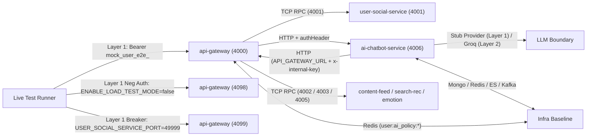

# Live Verification 2-Layer Plan for AI Chatbot (`update/ai-chatbot`)

* **Author:** AI Chatbot Maintainers
* **Date:** 2026-11-15
* **Status:** Draft

---

## The Problem

The `update/ai-chatbot` branch introduces 16 commits across `ai-chatbot-service`, `api-gateway`, `emotion-intelligence-service`, and `packages/dtos`. These changes add Assistant Navigation and Discovery, Surface Context ingestion, Dynamic Tool Routing with downstream microservice calls, Context-Aware Action Execution and Audit, AI Privacy Policy Gate with Redis caching and a circuit breaker (`ChatbotService.resolveUserAiPolicy`), Memory Architecture v2 (long-term user fact extraction and retrieval), Multi-session History, and Stage 2 Hybrid Guard (a secondary classifier/policy filter after initial input checks).

Currently, automated verification for these changes relies on unit tests and in-process tests that do not exercise live service boundaries:
* `apps/ai-chatbot-service/tests/e2e/test_chatbot_api_e2e.py` and `test_assistant_actions_e2e.py` force `CHATBOT_DB_ENABLED=false` and `RAG_DOCS_ENABLED=false`, mocking downstream calls through FastAPI `TestClient`.
* `apps/ai-chatbot-service/tests/integration/test_integration.py` tests isolated repositories via `testcontainers`, without `api-gateway` or NestJS microservices.

As a result, there is no automated verification that HTTP/TCP/Kafka contracts, Clerk authentication header forwarding, `aiPolicy` enforcement and circuit breaking, multi-store persistence, write-action execution, or real Groq LLM tool-calling work end-to-end across running services.

## Overview

This design defines a **2-Layer Live Verification** suite that tests the real cross-service integration without burning Groq token quotas or introducing flaky prose assertions:

1. **Layer 1 (Live Infrastructure & Cross-Service Integration):** Runs against live infrastructure (`docker-compose` baseline: `redis`, `elasticsearch`, `kafka`, plus external/local PostgreSQL and MongoDB via `DATABASE_URL` and `MONGO_URL`) and targeted service slices (`api-gateway`, `ai-chatbot-service`, and required NestJS microservices) using a deterministic LLM stub provider, isolated test user prefixes (`mock_user_e2e_<runId>_`), and prefix-scoped teardown.
2. **Layer 2 (Real LLM Smoke Suite):** Runs an opt-in, quota-capped suite (`RUN_LLM_SMOKE=true`) of 4 single-turn probes against the real `GROQ_API_KEY`, asserting structural invariants (HTTP status, valid tool-calling schemas, catalog `destinationId` membership, and Stage 2 guard decisions) rather than exact wording.

## Goals

* **Verify Cross-Service Contracts Live:** Verify that `api-gateway`, `ai-chatbot-service`, and downstream NestJS services (`user-social-service`, `content-feed-service`, `search-recommendation-service`, `emotion-intelligence-service`) communicate as expected over real HTTP, TCP RPC, and Kafka.
* **Verify Auth Forwarding & Privacy Gate Resilience:** Verify that `Authorization: Bearer mock_user_<id>` forwards cleanly through `api-gateway`, invalid/missing Clerk JWTs are rejected when `ENABLE_LOAD_TEST_MODE=false`, and `ChatbotService.resolveUserAiPolicy` caches `"FULL"` vs `"RESTRICTED"` (controlling whether personal tools and Memory v2 are enabled) in Redis and fails closed to `"RESTRICTED"` when the circuit breaker trips—without polluting other tests.
* **Verify Stateful Persistence & Safe Teardown:** Verify that Memory v2, multi-session history, and write-action execution (two-step `proposalToken` generation followed by confirmed execution with `idempotencyKey` and audit logging) persist accurately across MongoDB, Redis, and PostgreSQL, and clean up strictly by user prefix without wiping shared seed data.
* **Verify Real LLM Compatibility Within Budget:** Verify that real Groq API calls produce valid tool-calling schemas, valid `destinationId` resolution against `destinations.yaml`, and expected Stage 2 hybrid guard behavior within a fixed call and token budget.

## Non-Goals

* **Load & Stress Benchmarking:** High-concurrency throughput and latency SLA certification are out of scope.
* **Observability & Notification Stack Verification:** Jaeger, Prometheus, Grafana, Loki, and RabbitMQ push notifications are excluded from the baseline test topology.
* **Exact-String LLM Prose Matching:** Tests will not assert exact wording of natural-language LLM replies.
* **Production Logic Rewrites:** Existing production code will not be refactored solely to accommodate tests, aside from a guarded deterministic LLM stub provider mode for Layer 1.

---

## Technical Plan

### 1. Architecture & Boundary Split

The verification harness splits at the LLM boundary to separate deterministic cross-service integration (**Layer 1**) from live model behavior (**Layer 2**):

### 2. Minimal Infrastructure & Service Slices

Instead of booting all 7 services and the monitoring stack for every test, tests run against `docker compose up -d redis elasticsearch kafka` plus local/external PostgreSQL (`DATABASE_URL`) and MongoDB (`MONGO_URL`), and three targeted service slices:

* **Slice 1A — Gateway, Auth, Privacy Gate, Memory v2 & Multi-Session:**
  * *Services:* `api-gateway` (`4000`, `ENABLE_LOAD_TEST_MODE=true`), `ai-chatbot-service` (`4006`, `CHATBOT_LLM_STUB_MODE=true`), `user-social-service` (`4001`).
  * *Coverage:* `Authorization: Bearer mock_user_<id>` forwarding from `ChatbotController.respond` (`POST /api/v1/assistant/respond`) to `ai-chatbot-service`; `aiPolicy` `"FULL"` vs `"RESTRICTED"` resolution and Redis caching (`user:ai_policy:${userId}`); Memory Architecture v2 fact extraction/persistence; multi-session conversation creation, listing, and switching.
* **Slice 1B — Dynamic Tool Router, Navigation & Action Execution:**
  * *Services:* Slice 1A + `content-feed-service` (`4002`), `search-recommendation-service` (`4003`), `emotion-intelligence-service` (`4005`).
  * *Coverage:* Surface context ingestion, tool routing from `ai-chatbot-service` back through `api-gateway` (`API_GATEWAY_URL`, forwarding `Authorization` and `x-internal-key`) to TCP services (friends, search, trending, emotion insights), mini-cards payload (structured card summaries attached to replies), and context-aware action proposals (`proposalToken` generation, execution with `idempotencyKey`, and MongoDB audit log verification).
* **Slice 1C — Async Proactive Intervention (Kafka):**
  * *Services:* `emotion-intelligence-service` (`4005`), `ai-chatbot-service` (`4006`), Kafka, MongoDB, Redis.
  * *Coverage:* Publishing `analysis-events` over Kafka without `api-gateway` in the loop, verifying `ai-chatbot-service` `processed_events` idempotency and MongoDB `emotion_aggregates` / `outbox_events` persistence, `analysis-result-events` delivery to Redis (`chatbot:emotion:acute:{user_id}`), and `emotion-intelligence-service` `user_risk_states` / `intervention_logs` updates.

### 3. Auth Forwarding & Negative JWT Smoke Test

* **Functional Slices (1A, 1B):** Run `api-gateway` (`4000`) with `ENABLE_LOAD_TEST_MODE=true` and send `Authorization: Bearer mock_user_e2e_<runId>_<case>` (never `x-mock-user-id` alone) so `ClerkAuthGuard` populates `req.user` and `ChatbotController` forwards a non-empty `authHeader` downstream.
* **Negative Auth Smoke Check:** Launch an isolated `api-gateway` instance (`GATEWAY_PORT=4098`, `METRICS_PORT=5098`, `ENABLE_LOAD_TEST_MODE=false`), poll `http://localhost:4098/api/v1/health`, send missing and malformed Bearer tokens to `POST /api/v1/assistant/respond`, confirm HTTP `401` or `403`, and terminate the process in a `finally` block.

### 4. Circuit Breaker Isolation (`ChatbotService.resolveUserAiPolicy`)

Because `policyConsecutiveFailures` (threshold `3`) and `policyCircuitOpenUntil` live in process-global memory on `ChatbotService`, triggering the breaker in the main `api-gateway` instance would force `"RESTRICTED"` for all users for 10 seconds.

* **Isolation Mechanism:** Launch a short-lived secondary `api-gateway` process with `GATEWAY_PORT=4099`, `METRICS_PORT=5099`, `USER_SOCIAL_SERVICE_PORT=49999`, and `ENABLE_LOAD_TEST_MODE=true`, poll `http://localhost:4099/api/v1/health`, ensure `user:ai_policy:mock_user_e2e_<runId>_cb` is absent from Redis, send 3 requests to trigger 3 `1000ms` TCP timeouts, assert the 4th request fails closed to `"RESTRICTED"` in under `100ms`, and terminate the process in a `finally` block.
* This tests the real `firstValueFrom(...pipe(timeout(1000)))` error path without modifying production code or affecting Slice 1A/1B.

### 5. Deterministic LLM Stub (Layer 1) vs. Real Groq Smoke (Layer 2)

* **Layer 1 (`CHATBOT_LLM_STUB_MODE=true`):** Register a deterministic `LlmProvider` at the shared provider boundary in `ai-chatbot-service` (implementing both `generate(...)` and `stream(...)`, used by `RespondCommand` and `FactExtractorService`). Startup must fail fast if `CHATBOT_LLM_STUB_MODE=true` when `ENV=production`, and `GET /ready` must allow readiness when `CHATBOT_LLM_STUB_MODE=true`. The stub keys off explicit prompt markers:
  * `[STUB:NAV_HOME]` -> returns navigation `destinationId: "home"`.
  * `[STUB:TOOL_FRIENDS]` -> invokes `friends` tool call.
  * `[STUB:ACTION_POST]` -> emits action proposal with `proposalToken`.
  * `[STUB:FACT_EXTRACT]` -> returns deterministic Memory v2 fact JSON.
  * All FastAPI routing, Pydantic validation, MongoDB/Redis/ES persistence, and downstream NestJS calls remain live.
* **Layer 2 (`RUN_LLM_SMOKE=true` + real `GROQ_API_KEY`):** Opt-in suite capped at 4 single-turn probes with hard limits (`max_tokens <= 512`, max `2` tool-calling iterations per probe, max `1` retry on `429`):
  1. Vietnamese navigation prompt (`"Mở trang chủ giúp tôi"`) -> HTTP `200` and returned `destinationId` exists in `destinations.yaml`.
  2. Tool-calling prompt (`"Xem danh sách bạn bè của tôi"`) -> valid structured tool arguments and non-empty response contract.
  3. Action-proposal prompt (`"Tạo bài viết mới với nội dung Hello"`) -> valid `proposalToken` and action schema.
  4. Stage 2 hybrid guard adversarial/distress prompt -> expected guard block or safe crisis fallback.

### 6. Namespaced Seeding & Async-Safe Teardown

* **Namespace:** Every test run generates a unique `<runId>` and creates users/conversations prefixed with `mock_user_e2e_<runId>_`.
* **Setup:** Verify baseline ES indices via `npm run seed:search` and `npm --workspace=ai-chatbot-service run rag:index-docs`. Seed isolated test user(s) in PostgreSQL (`users` and `profiles` tables with `profiles.privacy_settings->>'aiPolicy'` set to `"FULL"` or `"RESTRICTED"`) and ensure `user:ai_policy:mock_user_e2e_<runId>_*` is absent from Redis.
* **Teardown:** Delete records matching `mock_user_e2e_<runId>_` across PostgreSQL (`users` cascade to `profiles`), MongoDB (conversations, Memory v2 facts, action audit logs, `emotion_aggregates`, `processed_events`, `outbox_events`), Elasticsearch test documents, and Redis (never `FLUSHDB`). For Slice 1C Kafka flows (`analysis-events`, `analysis-result-events`), poll for the expected async side effect with a `10s` bounded timeout before running prefix cleanup.

### 7. Success Metrics & Risks

* **Success Metrics:** Layer 1 slices pass with `0` leaked `mock_user_e2e_<runId>_*` keys/records post-teardown; Layer 2 completes all 4 probes within `<= 12` total Groq requests.
* **Risks & Mitigations:**
  * *Port/process leaks from isolated gateways:* Mitigated by `try/finally` process termination and unique ephemeral ports (`4098`, `4099`).
  * *Groq rate-limit (`429`) flakiness:* Mitigated by keeping Layer 2 opt-in (`RUN_LLM_SMOKE=true`) with hard token/retry caps.

---

## Alternatives Considered

1. **All-in-One 7-Service + Real Groq E2E Suite**
   * *Mechanism:* Boot all 7 microservices (`api-gateway`, `user-social-service`, `content-feed-service`, `search-recommendation-service`, `chat-service`, `emotion-intelligence-service`, `ai-chatbot-service`), the full monitoring stack, and run every multi-turn E2E scenario directly against the live Groq API.
   * *Status:* Rejected by author: Running every scenario against real Groq consumes RPM/TPD token quotas (triggering 429s in `Resilient provider` retries) and causes flaky test runs due to non-deterministic prose and tool-argument variations. Booting `chat-service` and the observability stack also increases memory consumption and slows down failure triage for chatbot-focused tests.

2. **Keeping Only `FastAPI TestClient` + `testcontainers`**
   * *Mechanism:* Expand the existing `tests/e2e/test_chatbot_api_e2e.py` (mocked `TestClient` with `CHATBOT_DB_ENABLED=false`) and `tests/integration/test_integration.py` (isolated `testcontainers` repository tests) without running `api-gateway` or NestJS microservices.
   * *Status:* Rejected by author: In-process mocks cannot verify `ClerkAuthGuard` header forwarding (`ChatbotController.respond`), `ChatbotService` TCP RPC timeouts and circuit breaking (`resolveUserAiPolicy`), or real cross-service write-action execution and Kafka event consumption.

3. **Stopping `user-social-service` Mid-Suite for Circuit Breaker Testing**
   * *Mechanism:* Shut down or pause the live `user-social-service` container/process during the main Layer 1 run to force `resolveUserAiPolicy` failures.
   * *Status:* Rejected by author: Stopping a shared process mid-suite makes test runs slow and flaky, and trips `policyCircuitOpenUntil` globally in `api-gateway` for 10 seconds—silently forcing subsequent `"FULL"` policy tests to `"RESTRICTED"`. Pointing a dedicated secondary `api-gateway` instance at an unreachable `USER_SOCIAL_SERVICE_PORT` tests the real `timeout(1000)` failure path without cross-test pollution.

---

## Detailed Implementation

Required implementation changes:

1. **Deterministic LLM Stub Provider in `ai-chatbot-service`**
   * `apps/ai-chatbot-service/app/core/settings.py`: Add `CHATBOT_LLM_STUB_MODE: bool = False` and fail fast at startup if `CHATBOT_LLM_STUB_MODE=True` while `ENV == "production"`.
   * `apps/ai-chatbot-service/app/providers/stub_provider.py` (new) & shared provider factory (`app/providers/resilient_provider.py` / `app/modules/chatbot/services/fact_extractor.py`): Implement a deterministic `LlmProvider` (`generate` and `stream`) keyed off `[STUB:*]` prompt markers, and wire it so both `RespondCommand` and `FactExtractorService` use it when `CHATBOT_LLM_STUB_MODE=true`.
   * `apps/ai-chatbot-service/app/main.py`: Update `get_readiness_status()` (`/ready`) to return `200` when `CHATBOT_LLM_STUB_MODE=true` even if `GROQ_API_KEY` is empty.
   * `apps/ai-chatbot-service/.env.example`: Document `CHATBOT_LLM_STUB_MODE=false` and `RUN_LLM_SMOKE=false`.

2. **Live Test Harness, Seeding & Prefix-Scoped Cleanup**
   * `apps/ai-chatbot-service/requirements.txt`: Add `psycopg[binary]` for PostgreSQL seeding/cleanup.
   * `apps/ai-chatbot-service/tests/live/harness.py` (new): Using `unittest` conventions, provide helpers to:
     * Verify port readiness for the active slice (`4000` `api-gateway`, `4001` `user-social-service`, `4006` `ai-chatbot-service` `/ready`, and Slice 1B/1C ports when enabled).
     * Generate unique run namespaces (`mock_user_e2e_<runId>_<case>`), seed test users in PostgreSQL (`users` + `profiles` with `privacy_settings->>'aiPolicy'` set to `"FULL"` or `"RESTRICTED"`), and clear `user:ai_policy:mock_user_e2e_<runId>_*` in Redis before each case.
     * Perform prefix-scoped teardown across PostgreSQL (`users` cascade to `profiles`), MongoDB (conversations, Memory v2, action audit logs, `emotion_aggregates`, `processed_events`, `outbox_events`), Elasticsearch, and Redis without calling `FLUSHDB`.
     * Poll for expected async Kafka side effects (`10s` bounded timeout) before running teardown on Slice 1C.

3. **Layer 1 Live Integration Suites (`unittest`)**
   * `apps/ai-chatbot-service/tests/live/test_slice_1a_gateway_policy_memory.py` (new): Exercise Slice 1A (`api-gateway` + `user-social-service` + `ai-chatbot-service`):
     * Send `Authorization: Bearer mock_user_e2e_<runId>_*` to `POST /api/v1/assistant/respond` (`ENABLE_LOAD_TEST_MODE=true`) and verify `authHeader` reaches `ai-chatbot-service`.
     * Launch an isolated `api-gateway` (`GATEWAY_PORT=4098`, `METRICS_PORT=5098`, `ENABLE_LOAD_TEST_MODE=false`), poll `/api/v1/health`, verify missing/invalid Clerk JWTs to `POST /api/v1/assistant/respond` return `401` or `403`, and terminate in `finally`.
     * Verify `aiPolicy` `"FULL"` vs `"RESTRICTED"` enforcement and Redis caching (`user:ai_policy:${userId}`).
     * Launch a secondary `api-gateway` (`GATEWAY_PORT=4099`, `METRICS_PORT=5099`, `USER_SOCIAL_SERVICE_PORT=49999`, `ENABLE_LOAD_TEST_MODE=true`), trigger 3 TCP timeouts (`timeout(1000)`), verify the 4th call fails closed to `"RESTRICTED"` in under `100ms`, and terminate in `finally`.
     * Verify Memory Architecture v2 persistence (`[STUB:FACT_EXTRACT]`) and multi-session history (create, list, switch conversations) in live MongoDB and Redis.
   * `apps/ai-chatbot-service/tests/live/test_slice_1b_tools_and_actions.py` (new): Exercise Slice 1B (Slice 1A + `content-feed-service`, `search-recommendation-service`, `emotion-intelligence-service`):
     * Seed baseline friend/post/emotion records, send `[STUB:TOOL_FRIENDS]` with Surface Context, and verify tool routing via `API_GATEWAY_URL` and mini-card response contracts.
     * Send `[STUB:ACTION_POST]`, verify `proposalToken` generation, execute with `idempotencyKey`, verify duplicate-execution idempotency protection, and verify MongoDB audit log creation.
   * `apps/ai-chatbot-service/tests/live/test_slice_1c_kafka_intervention.py` (new): Exercise Slice 1C (`emotion-intelligence-service` + `ai-chatbot-service` + Kafka):
     * Publish an `analysis-events` payload over live Kafka and poll MongoDB (`emotion_aggregates`, `processed_events`, `user_risk_states`) and Redis (`chatbot:emotion:acute:{user_id}`) to verify consumer processing, idempotency, and proactive intervention state updates.

4. **Layer 2 Real Groq Smoke Suite (`unittest`)**
   * `apps/ai-chatbot-service/tests/live/test_layer2_groq_smoke.py` (new): Gated via `@unittest.skipUnless(os.getenv("RUN_LLM_SMOKE") == "true" and os.getenv("GROQ_API_KEY"), ...)` against `POST /api/v1/assistant/respond` (`max_tokens <= 512`, max `2` tool iterations, max `1` retry):
     * Vietnamese navigation prompt (`"Mở trang chủ giúp tôi"`) -> HTTP `200` and `destinationId` present in `apps/ai-chatbot-service/app/modules/chatbot/navigation/destinations.yaml`.
     * Tool-calling prompt (`"Xem danh sách bạn bè của tôi"`) -> valid structured tool arguments and non-empty `reply` field.
     * Action-proposal prompt (`"Tạo bài viết mới với nội dung Hello"`) -> valid `proposalToken` and `action` schema.
     * Adversarial/distress prompt -> expected Stage 2 hybrid guard block or safe crisis fallback.

5. **Runner Scripts & Documentation**
   * `apps/ai-chatbot-service/package.json`: Scope `test` to `tests/unit` and `tests/e2e` so `npm test` does not discover `tests/live`, and add `test:live:layer1` (`cross-env CHATBOT_LLM_STUB_MODE=true node run-venv.js python -m unittest discover -s tests/live -p "test_slice_*.py"`) and `test:live:layer2` (`cross-env RUN_LLM_SMOKE=true node run-venv.js python -m unittest tests/live/test_layer2_groq_smoke.py`).
   * `apps/ai-chatbot-service/README.md`: Document minimal `docker-compose` startup (`redis`, `elasticsearch`, `kafka`), external/local MongoDB and PostgreSQL setup (`MONGO_URL`, `DATABASE_URL`), per-slice service startup with required env flags, and commands to run Layer 1 and Layer 2.
