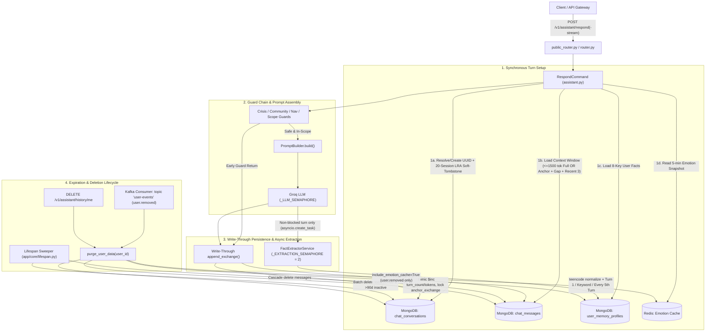

# AI Chatbot Memory Architecture (MongoDB-Centric, v2)

*   **Author:** Co Quach [Intern]
*   **Status:** Draft
*   **Date:** 2026-11-13

--------------------------------------------------------------------------------

## Overview

The `ai-chatbot-service` provides conversational mental-wellness and academic/lifestyle support to users across multiple chat sessions. Today, conversation history is split between Redis (`SessionMemory`) and MongoDB (`ChatHistoryRepository`), while the prompt builder truncates history to the last 2 turns (4 messages, capped at 280 characters each) and has no persistent store for long-term user traits.

This design consolidates conversation state and long-term user memory into MongoDB, removes Redis from chat history management, fixes cross-conversation context leakage, preserves the opening problem statement alongside recent turns within a deterministic token budget, and enforces lifecycle rules for 20-session quotas, 90-day inactivity expiration, and account/history deletion across REST and Kafka (`user.removed`).

## The Problem

Users interacting with the chatbot experience four concrete failure modes caused by the current storage and prompt-assembly design:

1.  **Cross-Conversation Context Leakage and Stale Reads:**
    *   `assistant.py::_session_key` hardcodes every Redis session key to `{userId}:default` regardless of `conversationId`. When a user switches between two separate conversations, messages from one conversation overwrite and leak into the other.
    *   `HistoryStore._history_cache` keys cached message pages only by `(user_id, page_size)` without `conversation_id`, returning history from the wrong conversation.
    *   When `request.conversationId` is `None` or `"default"`, `RespondCommand` returns `"conversationId": "default"` to the caller because the real UUID is only generated inside the asynchronous `HistoryStore._write_queue` worker. If `SessionMemory` is removed without fixing write ordering, a follow-up message on Turn $N+1$ can query MongoDB before Turn $N$ has been flushed from the in-memory queue (violating read-your-own-writes consistency).

2.  **Loss of Opening Problem Context After Turn 2:**
    *   `PromptBuilder._build_history_block()` slices `history[-4:]` (`CHATBOT_PROMPT_HISTORY_ITEMS_MAX = 4`, which equals 2 user+assistant turns) and truncates every historical message to 280 characters (`CHATBOT_PROMPT_HISTORY_ITEM_CHAR_LIMIT = 280`).
    *   In a mental-wellness or personal-coaching conversation where a user states their main problem in Turn 1 (or Turn 2 after an initial `"Xin chào"` greeting), the bot forgets the original problem by Turn 3 or Turn 4.

3.  **Premature Message Deletion and Orphaned Records from Independent TTL Indexes:**
    *   MongoDB currently uses two separate 90-day TTL indexes: `chat_conv_ttl_idx` on `chat_conversations.last_message_at` and `chat_msg_ttl_idx` on `chat_messages.created_at`.
    *   Because `chat_messages.created_at` never updates when a conversation continues, MongoDB deletes early turns of an active conversation once those individual messages pass 90 days. Conversely, when a conversation is evicted or deleted without cascading cleanup, orphaned message documents remain in `chat_messages`.

4.  **No Cross-Session User Profile Memory or Account-Deletion Purge:**
    *   When a user starts a new conversation, the assistant loses basic user traits shared in prior sessions (such as name, occupation, sleep habits, or preferred communication tone).
    *   When a user deletes their account in `user-social-service` (which emits `user.removed` on Kafka topic `user-events`), `ai-chatbot-service` does not consume the event, leaving the user's conversations, messages, user traits, and the Redis emotion cache (`chatbot:emotion:{user_id}`) stored indefinitely.

## Goals

*   **Zero Cross-Conversation Leakage:** Isolate every conversation by its resolved UUID across MongoDB queries, in-memory caches (`(user_id, conversation_id, page_size)`), and `/v1/assistant` endpoints, and never return `"default"` as a `conversationId`.
*   **Read-Your-Own-Writes Without Redis History:** Write each turn exchange directly to MongoDB within `CHATBOT_HISTORY_PERSIST_TIMEOUT_MS` before completing the turn, so an immediate Turn $N+1$ request sees Turn $N$. If the write times out, the turn returns `persisted=False` and the exchange is not queued.
*   **Token-Budgeted Context Continuity:** Include 100% of conversation turns when estimated tokens are $\le 1,500$. When a conversation exceeds $1,500$ tokens, include the first substantive exchange (`anchor_exchange`, skipping trivial greeting Turn 1s), a gap marker, and up to the 3 most recent turns within a $2,000$-token ceiling, requiring only a single `limit(6)` query on `chat_messages`.
*   **Bounded, Guard-Safe Cross-Session User Facts:** Persist up to 8 canonical user fact keys (`name`, `occupation`, `work_mode`, `sleep_health`, `diet_exercise`, `interests`, `current_goal`, `tone_preference`, max 100 characters per value) in `user_memory_profiles`, extracted asynchronously behind `asyncio.Semaphore(2)` only on safe (non-crisis, non-guard-blocked) turns.
*   **Unified Session Quota, 90-Day Inactivity Expiry, and Full Data Erasure:** Enforce a maximum of 20 active conversations per user via Least-Recently-Active (LRA) soft-tombstoning, expire inactive conversations as a whole unit 90 days after `last_message_at`, and purge all user data (`chat_conversations`, `chat_messages`, and `user_memory_profiles`) on `ClearHistoryCommand` and Kafka `user.removed` events, and delete the Redis emotion cache (`chatbot:emotion:{user_id}`) on `user.removed` only.

## Non-Goals

*   Pinned or favorite conversations that bypass the 20-active-session limit.
*   A dedicated frontend settings UI for inspecting or manually editing individual keys inside `user_memory_profiles`.
*   WebSocket or push notifications to notify clients when an old conversation expires or is evicted.
*   Vector or embedding-based semantic search across historical conversation turns.
*   Expanding the `intent` classification taxonomy or modifying RAG/Scope Guard routing logic (handled as a separate RAG/routing topic; this design consumes any `intent: str | None` produced by the existing guard and RAG pipeline).
*   Storing transient emotional states or clinical/psychological labels in `user_memory_profiles` (real-time emotional state and `TONE_DIRECTIVE` remain governed exclusively by `EmotionContextService` via `emotion_aggregates` to avoid stale mood poisoning and medical diagnosis violations).

## Open Questions

*   None.

## Critical User Journeys (CUJs)

### CUJ 1: Multi-Turn Context Preservation Across Short and Long Conversations

*   **Given**: A user starts a new conversation (`conversationId` omitted or `"default"`). In Turn 1, the user sends `"Xin chào"` (a trivial greeting). In Turn 2, the user explains their core issue (insomnia before exams). The conversation then continues through Turn 10 ($> 1,500$ estimated tokens).
*   **When**: The user sends Turn 11 asking for a summary of advice for their initial problem.
*   **Then**:
    *   Turn 1 returned a real UUID `conversationId` (not `"default"`), and every subsequent turn read its immediately preceding turn without race conditions.
    *   During Turns 1–6 ($\le 1,500$ tokens), 100% of turns were passed to the LLM without truncation.
    *   On Turn 11 ($> 1,500$ tokens), the prompt includes Turn 2 as the `anchor_exchange` (having skipped the Turn 1 greeting), the gap marker `"[... Một số lượt trao đổi trung gian đã được lược bớt ...]"`, and Turns 8–10 (the 3 most recent turns), enabling the assistant to reference the initial insomnia problem accurately.

### CUJ 2: Cross-Session User Fact Recall and Conflict Update

*   **Given**: In Conversation A, a user mentions they work night shifts as a software engineer (`occupation`, `work_mode`), and background extraction writes those keys to `user_memory_profiles`. Later, the user deletes Conversation A via `DeleteConversationCommand` and starts Conversation B, where they state they quit their job and are now a full-time student.
*   **When**: The user chats in Conversation B and sends subsequent messages.
*   **Then**:
    *   Deleting single Conversation A removed Conversation A and its messages but kept `user_memory_profiles` intact.
    *   When the user states in Conversation B that they are now a full-time student, background extraction updates `occupation` via atomic `$set` (and removes retracted keys via `$unset` if applicable) so future turns reflect the updated trait.

### CUJ 3: Session Quota Eviction, Clear All History, and Kafka Account Deletion

*   **Given**: A user has 20 active conversations and a populated `user_memory_profiles` document.
*   **When**:
    1.  The user creates a 21st conversation.
    2.  Later, the user either triggers `DELETE /v1/assistant/history/me` (`ClearHistoryCommand`) or deletes their account in `user-social-service` (emitting `"user.removed"` on Kafka topic `"user-events"`).
*   **Then**:
    1.  On the 21st conversation creation, the active conversation with the oldest `last_message_at` is immediately marked `status: "tombstoned"` (excluded from all list/read queries) and deleted with its messages asynchronously, while `user_memory_profiles` remains intact.
    2.  On `ClearHistoryCommand` or Kafka `"user.removed"`, `purge_user_data(user_id)` removes all `chat_conversations`, `chat_messages`, and `user_memory_profiles` documents for `user_id` (and on `"user.removed"` only, also deletes `chatbot:emotion:{user_id}` from Redis).

## Technical Plan (Architecture)

### 1. High-Level Architecture & Data Flow

The architecture removes `SessionMemory` (Redis) from chat history management and consolidates all conversational state and long-term user facts into three MongoDB collections: `chat_conversations`, `chat_messages`, and `user_memory_profiles`. Redis remains in use only for the 5-minute emotion analysis cache (`EmotionContextService`).



### 2. MongoDB Schema & Index Design

#### A. `chat_conversations` Collection
Stores one document per conversation session and tracks token estimates and the opening substantive exchange so long-conversation context loads require no extra query for Turn 1:

```python
{
    "id": "550e8400-e29b-41d4-a716-446655440000",  # UUIDv4 string
    "user_id": "user_123",
    "title": "Mất ngủ trước kỳ thi...",
    "status": "active",          # "active" | "tombstoned"
    "is_archived": False,
    "turn_count": 7,             # Incremented atomically by +1 per exchange
    "total_tokens_est": 1640,    # Incremented atomically by +exchange_tokens_est
    "anchor_exchange": [         # Locked on first substantive turn (max 2 dicts: user + assistant)
        {"id": "...", "role": "user", "content": "...", "created_at": datetime(...)},
        {"id": "...", "role": "assistant", "content": "...", "created_at": datetime(...)},
    ],
    "anchor_turn": 2,            # Turn number on which anchor_exchange was locked
    "created_at": datetime(...),
    "updated_at": datetime(...),
    "last_message_at": datetime(...),  # Governs rolling 90-day inactivity window
}
```

*   **Index Migration in `ensure_indexes()`**:
    *   Explicitly drop legacy TTL index `chat_conv_ttl_idx` on `chat_conversations` and `chat_msg_ttl_idx` on `chat_messages` (ignoring `OperationFailure` if already absent).
    *   Create compound index `chat_conv_user_status_idx` on `[("user_id", 1), ("status", 1), ("last_message_at", -1)]` to serve active-session listing, LRA eviction sorting, and 20-session counting.
    *   Create unique index `chat_conv_id_uniq_idx` on `[("id", 1)]` so two conversations never share an `id` (log and continue if existing duplicates block creation).
    *   Create indexes `chat_conv_sweeper_status_idx` on `[("status", 1)]` and `chat_conv_sweeper_lma_idx` on `[("last_message_at", 1)]` so each branch of the sweeper query uses an index.

#### B. `chat_messages` Collection
Stores individual user and assistant messages tied to `conversation_id`:

```python
{
    "id": "7c9e6679-7425-40de-944b-e07fc1f90ae7",
    "conversation_id": "550e8400-e29b-41d4-a716-446655440000",
    "user_id": "user_123",
    "role": "user" | "assistant",
    "client_message_id": "client-uuid-1" | None,
    "content": "...",
    "intent": "mental_health",   # Open str | None from Guard Chain, NavResolver, or RAG/Scope inference
    "sources": [...],
    "meta": {"message_kind": "user" | "assistant", "actions": [...], "policyBlocked": False},
    "tokens_est": 85,
    "created_at": datetime(...),
}
```

*   **Intent Field Semantics (`intent: str | None`)**:
    *   Accepts any string resolved by the existing Guard Chain (`"mental_health_crisis"`, `"community_guard"`, `"greeting"`, `"out_of_scope"`, `"privacy"`, `"in_domain_unknown"`, `"clarify"`), Navigation Resolver (`nav.intent`), RAG context type (`"post"`, `"group"`, `"user"`, `"help_doc"`), or Scope Guard domain fallback (`"mental_health"`, `"emotion"`, `"social"`, `"account"`, etc.).
    *   Rather than hardcoding an allowlist of intents, both `anchor_exchange` locking and `FactExtractorService` evaluate a shared blocklist of non-substantive or guard-blocked intents (`NON_SUBSTANTIVE_INTENTS = frozenset({"greeting", "mental_health_crisis", "community_guard", "out_of_scope", "privacy", "in_domain_unknown", "clarify"})`), ensuring future RAG/routing intents work without schema changes.
*   **Indexes**: Retain compound index `chat_msg_conv_idx` on `[("conversation_id", 1), ("created_at", -1), ("id", -1)]`.

#### C. `user_memory_profiles` Collection (New)
Stores one document per user (`_id: user_id`) holding at most 8 canonical fact keys:

```python
{
    "_id": "user_123",
    "facts": {
        "name": "Minh",
        "occupation": "Sinh viên năm 3 ngành CNTT",
        "work_mode": "Học ca sáng, làm thêm buổi tối",
        "sleep_health": "Hay thức khuya đến 2h sáng, khó vào giấc",
        "diet_exercise": "Uống nhiều cà phê chiều, ít vận động",
        "interests": "Nghe nhạc indie, đọc sách tâm lý",
        "current_goal": "Cải thiện giấc ngủ trước kỳ thi cuối kỳ",
        "tone_preference": "Nhẹ nhàng, ngắn gọn, không dùng từ học thuật",
    },
    "updated_at": datetime(...),
}
```

*   **Schema Constraints & Separation from `EmotionContextService`**:
    *   Allowed keys (`CANONICAL_FACT_KEYS`): `{"name", "occupation", "work_mode", "sleep_health", "diet_exercise", "interests", "current_goal", "tone_preference"}`. Any other key output by the extractor LLM is discarded before database write.
    *   Transient emotions (*sadness, fear, anger, joy*) and psychological/clinical evaluations are intentionally excluded from `user_memory_profiles`. Short-term emotional state and `TONE_DIRECTIVE` are supplied by `EmotionContextService` (`emotion_aggregates`), preventing stale mood persistence across future sessions and enforcing the system prompt's medical non-diagnosis rule.
    *   Value length: Each value is normalized and truncated to at most `100` characters (`50–100` tokens total across the entire block).

### 3. Synchronous Conversation Resolution & Write-Through Persistence

1.  **Eliminating `"default"` Conversation IDs**:
    *   At the start of `RespondCommand.execute()` and `RespondCommand.execute_stream()`, call `conversation = await self.history_store.resolve_conversation(user_id=request.userId, conversation_id=request.conversationId)`.
    *   `resolve_conversation` delegates to `ChatHistoryRepository.get_or_create_conversation_by_user()`, which returns an active (`status != "tombstoned"`, `last_message_at >= cutoff`) conversation document with a real UUID `id`. If an explicit `conversationId` matches no active conversation for this user but a document with that `id` already exists (tombstoned, expired, or owned by another user), a new UUID is generated instead of reusing it.
    *   `request = request.model_copy(update={"conversationId": conversation["id"]})` is bound immediately so that guard responses, crisis Kafka alerts, SSE chunks, and final responses always carry the real UUID.
2.  **Read-Your-Own-Writes Guarantee**:
    *   `PersistHistoryCommand.execute()` calls `await self.store.persist_exchange(...)`, which writes directly through `self._repository.append_exchange(...)` with `client_message_id = request.clientMessageId or <request id>` (so a retry cannot insert the exchange twice) and a timeout of `settings.CHATBOT_HISTORY_PERSIST_TIMEOUT_MS / 1000`. On timeout it returns `persisted=False`; there is no background write queue. It invalidates `_history_cache` for `(user_id, conversation_id)` before `RespondCommand.execute()` returns. In `RespondCommand.execute_stream()`, `_after_generation()` (which persists) is awaited before the completion event is yielded on guard paths and before the stream closes on LLM paths.
    *   `HistoryStore._history_cache` keys entries by `(user_id, conversation_id, page_size)` instead of `(user_id, page_size)`.
3.  **Removing `SessionMemory` Call-Site Dependencies**:
    *   `last_intent`: Derived directly from `request.intent` or the `intent` field of the latest assistant message loaded from MongoDB for `conversation["id"]`.
    *   `_pick_recent_user_anchor(history)`: Scans the loaded `AssistantHistoryItem` list from newest to oldest without consulting `SessionMemory.get_facts()`.
    *   `ClearHistoryCommand`: Removes the `SessionMemory` dependency and calls `history_store.purge_user_data(user_id, include_emotion_cache=False)`.

### 4. Token-Budget + Substantive Anchor Window + Gap Marker Algorithm

#### A. Deterministic Token Estimation & Substantive Anchor Locking
*   **Token Estimator**:
    ```python
    def estimate_tokens(text: str) -> int:
        words = len((text or "").split())
        return max(1, int(words * 1.35))
    ```
*   **Substantive Anchor Rule in `append_exchange()`**:
    *   A turn is eligible to become `anchor_exchange` when:
        1. `conversation.get("anchor_exchange")` is empty (`None` or `[]`),
        2. `not policy_blocked`,
        3. `intent not in NON_SUBSTANTIVE_INTENTS`, and
        4. `normalized = teencode_normalizer.normalize(user_message).lower().strip(" .,!?…")` (`normalize` keeps case and punctuation), `len(normalized.split()) >= 4`, and `normalized` is not in `{"xin chào", "chào bạn", "chào", "hi", "hello", "hey", "alo"}`.
    *   When eligible, `append_exchange()` includes `"anchor_exchange": [{"id": user_msg_id, "role": "user", "content": user_message[:1200], "created_at": ...}, {"id": assistant_msg_id, "role": "assistant", "content": assistant_reply[:1200], "created_at": ...}]` and `"anchor_turn": conversation.turn_count + 1` (the turn number being written) in the `$set` update on `chat_conversations`, alongside `$inc: {"turn_count": 1, "total_tokens_est": turn_tokens}`.
    *   If Turn 1 is `"Xin chào"` (`intent == "greeting"` or $< 4$ words), `anchor_exchange` remains empty after Turn 1 and automatically locks onto Turn 2 when the user states their real issue.
    *   `append_exchange()` also returns `locked_anchor_this_turn` and the new `turn_count`, so `RespondCommand` does not recompute them.

#### B. Context Window Assembly (`load_context_window`)
Given the resolved `conversation` document:
1.  **Step 1 — Full History Within Token Budget (`total_tokens_est <= 1500`)**:
    *   If `conversation` has no `turn_count` (a pre-v2 document), first compute `turn_count`, `total_tokens_est`, `anchor_exchange`, and `anchor_turn` once from `chat_messages` and save them with `update_one`; then continue with the saved values.
    *   Query `chat_messages` for `conversation_id` sorted newest-first (`created_at DESC, id DESC`, limit 40), then reverse to chronological order, so the newest messages are never dropped.
    *   Return all loaded messages as `list[AssistantHistoryItem]`. Turns 1 through ~6 have no dropped messages and no gap between Turn 4 and Turn 5.
2.  **Step 2 — Substantive Anchor + Recent 3 Turns (`total_tokens_est > 1500`)**:
    *   Read `anchor_exchange` from `conversation.get("anchor_exchange") or []`.
    *   Query `chat_messages` newest-first (`created_at DESC, id DESC`) with `.limit(6)` (up to 3 recent user+assistant turns), then reverse to chronological order.
    *   Deduplicate: drop any message whose `id` is one of the `id` values in `anchor_exchange`. Call the result `recent_messages`.
    *   Do not truncate here. `PromptBuilder._build_history_block` applies the single 1,200-character cap; token estimates in this step use `content[:1200]`.
    *   **Hard Ceiling (`2,000` tokens)**: If the estimated tokens of `anchor + recent_messages` exceed `2,000`, drop the oldest pair from `recent_messages` until the total fits, always keeping at least the most recent turn (the last 2 messages).
3.  **Step 3 — Gap Marker Injection**: Using the final `recent_messages`, insert the marker below between the anchor items and `recent_messages` only if `anchor_exchange` is non-empty, `recent_messages` is non-empty, and `turn_count - len(recent_messages) // 2 > anchor_turn` (at least one turn lies between the anchor and the first recent turn). Example: anchor on Turn 2, `turn_count == 5`, recent turns 3–5 → `5 - 3 = 2`, which is not greater than `anchor_turn = 2`, so no marker. With `turn_count == 6`, recent turns 4–6 → `6 - 3 = 3 > 2`, so the marker is inserted.
    ```python
    AssistantHistoryItem(
        role="system",
        content="[... Một số lượt trao đổi trung gian đã được lược bớt ...]",
    )
    ```

#### C. `PromptBuilder` Assembly Order
`PromptBuilder.build()` assembles the final prompt in the following order:
1.  `_build_system_prompt()` + `_build_emotion_tone_directive(emotion_snapshot)` + `_build_surface_context_directive(request.surface)` + `_build_user_profile(request)`
2.  `_build_user_facts_block(user_facts: dict[str, str])`: Renders canonical `USER_FACTS` key-value lines (omitting empty keys; replaces `_build_memory_summary_block`).
3.  `_build_context_block(request.contexts, ...)` (RAG documents).
4.  `_build_history_block(history)`: Renders every item in the pre-selected `history` list in order (`user: ...`, `assistant: ...`, or `[... Một số lượt trao đổi trung gian đã được lược bớt ...]`), removing the legacy `history[-4:]` slice and `280`-character truncation.
5.  `_build_proactive_checkin_directive(emotion_snapshot)` or `_build_current_message(request.message)`.

### 5. Decoupled User Fact Store & Guard-Safe Hybrid Extraction

1.  **Isolation & Safety Gate**:
    *   `FactExtractorService` uses a module-level `_EXTRACTION_SEMAPHORE = asyncio.Semaphore(2)` so background fact extraction never competes with live chat generation on `_LLM_SEMAPHORE`.
    *   Extraction is scheduled via `asyncio.create_task(...)` only after a normal LLM reply completes when `not is_blocked` and `resolved_intent not in NON_SUBSTANTIVE_INTENTS`.
2.  **Hybrid Extraction Trigger**:
    *   Normalize `request.message` via `normalized_msg = teencode_normalizer.normalize(request.message)`.
    *   Evaluate trigger conditions against the updated conversation `turn_count`:
        *   **Trigger A (Opening Substantive Turn)**: `turn_count == 1` (or the turn that just locked `anchor_exchange`) AND `len(normalized_msg.split()) >= 8`.
        *   **Trigger B (Self-Disclosure Keywords)**: `normalized_msg.lower()` contains a self-disclosure pattern (`"tên là"`, `"mình tên"`, `"tôi là"`, `"mình là"`, `"làm nghề"`, `"công việc"`, `"sinh viên"`, `"học trường"`, `"làm ca"`, `"ngủ"`, `"mất ngủ"`, `"thức khuya"`, `"ăn uống"`, `"tập thể dục"`, `"chạy bộ"`, `"sở thích"`, `"thích nghe"`, `"mục tiêu"`, `"muốn cải thiện"`, `"gọi mình là"`, `"xưng hô"`, `"đừng gọi"`, `"không còn làm"`).
        *   **Trigger C (Periodic Batch)**: `turn_count > 1 and turn_count % 5 == 0`, where the extractor reads the last 5 user messages itself with `list_recent_user_messages(conversation_id, limit=5)` (the loaded context window can hold fewer).
3.  **Atomic Conflict Resolution**:
    *   The extractor prompt passes the current `facts` map (re-read from `user_memory_profiles` after the semaphore is acquired) and the user message(s), instructing the LLM (through `provider.generate(prompt, AssistantRespondRequest(userId=user_id, message=<last user message>, intent="fact_extraction"))`; `GroqProvider` maps a non-empty `intent` to `settings.GROQ_TEMPERATURE_TASK`) to output strict JSON:
        ```json
        {
          "set": {"occupation": "Sinh viên năm cuối"},
          "unset": ["work_mode"]
        }
        ```
    *   `UserMemoryProfileRepository.apply_fact_diff(user_id, to_set, to_unset)` filters keys against `CANONICAL_FACT_KEYS`, keeps only `str` values, collapses whitespace and newlines (`" ".join(v.split())[:100]`), removes any key in `to_set` from `to_unset` (MongoDB rejects one path in both `$set` and `$unset`), skips the write when both are empty, and executes a single atomic MongoDB `update_one({"_id": user_id}, update_doc, upsert=True)`.
4.  **Purge Safety**:
    *   `FactExtractorService` keeps `_inflight_tasks: dict[str, set[asyncio.Task]]`. `purge_user_data(user_id)` cancels and awaits that user's tasks before deleting `user_memory_profiles`. Before `apply_fact_diff`, `_run_extraction` confirms the source conversation is still active, so a task that outlives a purge cannot recreate the profile.

### 6. Session Quota (20 Sessions), 90-Day Expiry Sweeper, and Data Purge

1.  **Active Session Filter**:
    *   `ChatHistoryRepository._active_conversation_filter(user_id, cutoff)` returns:
        ```python
        {
            "user_id": user_id,
            "status": {"$ne": "tombstoned"},
            "$or": [
                {"last_message_at": {"$gte": cutoff}},
                {"last_message_at": None, "created_at": {"$gte": cutoff}},
            ],
        }
        ```
    *   Used across `get_or_create_conversation_by_user`, `list_conversations_by_user`, `list_messages_by_user`, and the 20-session `count_documents` check.
2.  **Two-Phase 20-Session LRA Eviction**:
    *   When creating a new conversation and `count_documents(active_filter) >= 20`, query the `(count - 19)` active conversations with the oldest `last_message_at` (`sort=[("last_message_at", 1), ("created_at", 1)]`).
    *   **Phase 1 (Synchronous Soft-Tombstone)**: Execute `conv_col.update_many({"id": {"$in": oldest_ids}}, {"$set": {"status": "tombstoned", "updated_at": now}})`.
    *   **Phase 2 (Asynchronous Cascade Delete)**: Spawn `asyncio.create_task(self._purge_conversations_by_ids(oldest_ids))` to delete the `chat_messages` and `chat_conversations` documents without blocking the turn. `user_memory_profiles` is untouched.
3.  **Periodic Lifespan Sweeper (`app/core/lifespan.py`)**:
    *   Starts a background task `history_store.run_sweeper_loop(interval_seconds=3600)` on service startup.
    *   Each sweep finds up to 200 conversations matching any of: `status == "tombstoned"`; `last_message_at < now - 90 days`; or `last_message_at == None and created_at < now - 90 days` (each branch uses its own index), deletes their `chat_messages` (`{"conversation_id": {"$in": batch_ids}}`), and deletes the `chat_conversations` documents.
4.  **Deletion & Kafka `user.removed` Consumer**:
    *   `DeleteConversationCommand`: Hard-deletes the single conversation and its `chat_messages`; keeps `user_memory_profiles` intact.
    *   `ClearHistoryCommand`: Calls `history_store.purge_user_data(user_id, include_emotion_cache=False)` which first cancels in-flight fact-extraction tasks for `user_id`, then deletes all `chat_conversations`, `chat_messages`, and `user_memory_profiles` for `user_id`.
    *   `user_event_consumer.py` (registered in `app/modules/analysis/lifespan.py` on topic `"user-events"`, group `f"{settings.KAFKA_CLIENT_ID}-chatbot-user"`): Parses outbox envelope (`msg.get("type") or msg.get("eventType") == "user.removed"`, extracting `userId` from `msg.get("payload", {})` or root `msg`), calls `history_store.purge_user_data(user_id, include_emotion_cache=True)`, which also deletes `chatbot:emotion:{user_id}` from Redis.
5.  **Public Router (`/v1/assistant`) Alignment**:
    *   Update `GET /v1/assistant/history/me` in `public_router.py` to accept `conversationId: Optional[str] = Query(default=None, max_length=128)` and pass it to `get_history_query.execute(...)`.
    *   Add `GET /v1/assistant/conversations`, `POST /v1/assistant/conversations`, and `DELETE /v1/assistant/conversations/{conversation_id}` to `public_router.py` using `require_gateway_user`.

## Alternatives Considered

### Alternative A: Three-Tier Architecture with Redis Short-Term Buffer (`SessionMemory` + MongoDB)

*   **Pros**: Avoids querying MongoDB for the recent turn window when a Redis entry is warm; keeps the existing `SessionMemory` abstraction in `app/modules/chatbot/services/memory.py`.
*   **Cons**: Requires dual-write synchronization across Redis and MongoDB on every turn, conversation-scoped cache invalidation across both stores, and fallback handling when Redis and MongoDB diverge. An indexed MongoDB query for 1 conversation document (`_id`/`id`) + 6 recent messages (`chat_msg_conv_idx`) already completes in single-digit milliseconds on a local/VPC MongoDB replica set.
*   **Reason for Rejection**: Adds dual-write complexity and cache synchronization overhead for negligible latency savings over an indexed MongoDB read.

### Alternative B: Naive Sliding Window (Fixed $N$ Turns)

*   **Pros**: Simple `find().sort().limit(2 * N)` query with no need to track `total_tokens_est` or `anchor_exchange` on `chat_conversations`.
*   **Cons**: Drops the opening problem statement once a conversation exceeds $N$ turns (creating an abrupt context break at Turn $N+1$) and treats short 5-word acknowledgments identically to 250-word explanations.
*   **Reason for Rejection**: Drops the opening problem statement after 4 turns and creates an abrupt context gap at Turn 5.

### Alternative C: Per-Conversation Fact Provenance Deletion (Method 2B)

*   **Pros**: Deleting a single conversation also deletes facts that were first extracted during that conversation via a `source_conversation_id` field.
*   **Cons**: User facts (such as `occupation` or `sleep_health`) are frequently mentioned or refined across multiple conversations, creating ownership conflicts over which `source_conversation_id` owns a shared key. In addition, users who delete a single old chat thread solely to clean up their sidebar unexpectedly lose cross-session assistant personalization.
*   **Reason for Rejection**: Attaching `source_conversation_id` to each fact causes ownership conflicts when facts are updated across multiple sessions and unexpectedly erases bot memory when users delete a single chat just to tidy their sidebar.

### Alternative D: Every-Turn LLM Fact Extraction (1:1 Extraction per Turn)

*   **Pros**: Captures any subtle fact disclosure without relying on Turn 1 length, keyword matching, or a 5-turn batch interval.
*   **Cons**: Doubles Groq API call volume (RPM and TPM) across all active chat sessions and wastes LLM quota on short acknowledgments (`"Cảm ơn bạn"`, `"Ok"`), navigation commands, or general app-feature questions.
*   **Reason for Rejection**: Doubles Groq API request consumption (RPM/TPM) and wastes quota on short acknowledgments or navigation commands.

### Alternative E: Independent MongoDB TTL Indexes on Conversations and Messages

*   **Pros**: Uses built-in MongoDB background TTL threads without application-level active filters or a lifespan sweeper task.
*   **Cons**: MongoDB TTL indexes evaluate each document's indexed timestamp independently and do not support cross-collection cascading deletes. Indexing `chat_messages.created_at` deletes early messages from an active conversation once those individual messages pass 90 days, while evicting or deleting a conversation leaves orphaned messages behind.
*   **Reason for Rejection**: Truncates early messages in active conversations and leaves orphaned messages because MongoDB TTL indexes do not cascade across collections.

### Alternative F: Storing Emotional or Psychological State Keys in `user_memory_profiles`

*   **Pros**: Persists chat-disclosed mood across sessions even when a user has not published social feed posts analyzed by `emotion_aggregates`.
*   **Cons**: Emotions are transient states rather than durable traits; storing mood in `user_memory_profiles` causes stale mood poisoning in later sessions when a user's emotion has already recovered without triggering a new extraction turn. It also creates conflicting prompt directives against `EmotionContextService` (`TONE_DIRECTIVE`) and risks generating quasi-clinical psychological labels that violate the system prompt's medical non-diagnosis policy.
*   **Reason for Rejection**: Moods go stale across sessions, conflict with the `TONE_DIRECTIVE` from `EmotionContextService`, and risk quasi-clinical labels. `user_memory_profiles` keeps only the 8 non-clinical lifestyle/preference keys.

--------------------------------------------------------------------------------

## Non-Functional Requirements

*   **Security & Privacy**:
    *   Fact extraction is skipped on every intent in `NON_SUBSTANTIVE_INTENTS` (including crisis, community-violation, and out-of-scope turns) and on policy-blocked (`policyBlocked`) turns so crisis disclosures and prompt-injection payloads are never written to `user_memory_profiles`.
    *   `ClearHistoryCommand` (`DELETE /v1/assistant/history/me` and `DELETE /assistant/history/{user_id}`) and Kafka `"user.removed"` events on `"user-events"` execute `purge_user_data(user_id)` to erase all conversations, messages, and `user_memory_profiles` (plus Redis emotion cache keys on account deletion).
*   **Performance & Latency**:
    *   Long-conversation context assembly (`total_tokens_est > 1500`) reads `anchor_exchange` directly from the already-loaded `chat_conversations` document and executes a single indexed `limit(6)` query on `chat_messages` (`chat_msg_conv_idx`).
    *   20-session quota eviction performs only a synchronous `update_many` (`status: "tombstoned"`) on the request path and offloads message and conversation deletion to an asynchronous task.
    *   Background LLM fact extraction is isolated behind `_EXTRACTION_SEMAPHORE = asyncio.Semaphore(2)` so it cannot starve user-facing chat generations gated by `_LLM_SEMAPHORE`.
*   **Rollout & Backward Compatibility**:
    *   Existing `chat_conversations` documents created before this rollout lack `status`, `turn_count`, `total_tokens_est`, and `anchor_exchange`. All read queries treat missing `status` as `"active"` (`"status": {"$ne": "tombstoned"}`) When `load_context_window` finds a conversation with no `turn_count`, it computes `turn_count`, `total_tokens_est`, `anchor_exchange`, and `anchor_turn` once from `chat_messages` and saves them with `update_one`, so an old conversation does not lock a late turn as its anchor.
    *   `ensure_indexes()` drops legacy `chat_conv_ttl_idx` and `chat_msg_ttl_idx` idempotently on startup.

--------------------------------------------------------------------------------

## Additional Resources

*   [Predecessor Ideation Brief](../../concepts_brief.md)
*   [Existing History Repository (`chat_history.py`)](../../SE121-microservices/apps/ai-chatbot-service/app/modules/chatbot/repositories/chat_history.py)
*   [Existing Assistant Service (`assistant.py`)](../../SE121-microservices/apps/ai-chatbot-service/app/modules/chatbot/services/assistant.py)
*   [Upstream Kafka Publisher for `user.removed` (`user.service.ts`)](../../SE121-microservices/apps/user-social-service/src/modules/user/user.service.ts)

## Future Improvements

*   **User-Facing Memory Control UI**: Expose a dedicated `GET /v1/assistant/memory/me` and `DELETE /v1/assistant/memory/me/{key}` endpoint pair so users can view or delete individual keys in `user_memory_profiles` from the frontend settings screen.
*   **Dedicated Intent & RAG Routing Upgrade**: Expand the Scope Guard and RAG domain intent taxonomy in a dedicated RAG/routing design without requiring schema changes in `chat_messages`.

--------------------------------------------------------------------------------

## Detailed Implementation Plan

### Target Files to Create/Modify

#### 1. `SE121-microservices/apps/ai-chatbot-service/app/modules/chatbot/repositories/user_memory_profile.py` (Create)

*   **Type / Scope**: Python MongoDB Repository (`motor.motor_asyncio`)
*   **Rationale**: Provides isolated CRUD and atomic `$set`/`$unset` operations for the new `user_memory_profiles` collection while enforcing the 8-key canonical schema and 100-character value bound.
*   **Proposed Changes**:
    *   Define `CANONICAL_FACT_KEYS = frozenset({"name", "occupation", "work_mode", "sleep_health", "diet_exercise", "interests", "current_goal", "tone_preference"})` and `MAX_FACT_VALUE_CHARS = 100`.
    *   Implement `UserMemoryProfileRepository(db: AsyncIOMotorDatabase | None = None)` with an in-memory dictionary fallback when `not settings.CHATBOT_DB_ENABLED`.
    *   `async def get_facts_by_user(self, user_id: str) -> dict[str, str]`: Fetches `{"_id": user_id}` from `user_memory_profiles` and returns a filtered `dict[str, str]` containing only non-empty canonical keys.
    *   `async def apply_fact_diff(self, user_id: str, to_set: dict[str, str], to_unset: list[str] | set[str]) -> dict[str, str]`: Filters `to_set` and `to_unset` against `CANONICAL_FACT_KEYS`, keeps only `str` values, collapses whitespace (`" ".join(v.split())[:100]`), removes keys in `to_set` from `to_unset`, returns early if both are empty, builds a single MongoDB update document (`{"$set": {"facts.<k>": v, "updated_at": now}, "$unset": {"facts.<u_k>": ""}}`), and executes `update_one({"_id": user_id}, update_doc, upsert=True)`.
    *   `async def delete_by_user(self, user_id: str) -> bool`: Deletes `{"_id": user_id}` from `user_memory_profiles`.

#### 2. `SE121-microservices/apps/ai-chatbot-service/app/modules/chatbot/services/fact_extractor.py` (Create)

*   **Type / Scope**: Python Asynchronous Background Service
*   **Rationale**: Decouples LLM user-trait extraction from the live chat response path, bounds concurrency via `asyncio.Semaphore(2)`, blocks extraction on crisis/guard turns, and applies the hybrid trigger (`teencode_normalizer` + Turn 1 / keyword / every 5th turn).
*   **Proposed Changes**:
    *   Define module-level `_EXTRACTION_SEMAPHORE = asyncio.Semaphore(2)` and import `NON_SUBSTANTIVE_INTENTS` from `chat_history.py` (the single definition, shared with `append_exchange`).
    *   Define `SELF_DISCLOSURE_PATTERNS: tuple[str, ...]` covering Vietnamese and English personal trait disclosures and retractions (`"tên là"`, `"mình tên"`, `"tôi là"`, `"mình là"`, `"làm nghề"`, `"công việc"`, `"sinh viên"`, `"học trường"`, `"làm ca"`, `"ngủ"`, `"mất ngủ"`, `"thức khuya"`, `"ăn uống"`, `"tập thể dục"`, `"chạy bộ"`, `"sở thích"`, `"thích nghe"`, `"mục tiêu"`, `"muốn cải thiện"`, `"gọi mình là"`, `"xưng hô"`, `"đừng gọi"`, `"không còn làm"`, `"nghỉ việc"`).
    *   Implement `FactExtractorService(provider: LlmProvider, profile_repo: UserMemoryProfileRepository)`:
        *   `should_extract(user_message: str, turn_count: int, locked_anchor_this_turn: bool, intent: str | None, policy_blocked: bool) -> tuple[bool, str]`: Returns `(False, "")` if `policy_blocked` or `intent in NON_SUBSTANTIVE_INTENTS`. Normalizes `user_message` via `teencode_normalizer.normalize(user_message).lower()` from `app.utils.teencode.teencode_normalizer`. Returns `True` if:
            1. `(turn_count == 1 or locked_anchor_this_turn)` and `len(normalized.split()) >= 8`, OR
            2. Any keyword in `SELF_DISCLOSURE_PATTERNS` appears in `normalized.lower()`, OR
            3. `turn_count > 1 and turn_count % 5 == 0`.
        *   `maybe_schedule_extraction(...) -> asyncio.Task | None`: Checks `should_extract` and spawns a non-blocking `asyncio.create_task(self._run_extraction(...))` and records it in `self._inflight_tasks[user_id]` (a `dict[str, set[asyncio.Task]]`, cleaned by `task.add_done_callback`). Add `async def cancel_user_tasks(self, user_id: str) -> None`, which cancels and awaits that user's tasks.
        *   `async def _run_extraction(self, user_id: str, conversation_id: str, turn_count: int, last_user_message: str) -> None`: Acquires `_EXTRACTION_SEMAPHORE`, then re-reads `current_facts` with `profile_repo.get_facts_by_user(user_id)`. When `turn_count % 5 == 0` it loads the last 5 user messages with `list_recent_user_messages(conversation_id, limit=5)`; otherwise it analyzes `last_user_message`. It builds an extraction prompt instructing the LLM to extract only durable lifestyle/personal traits into the 8 canonical keys (explicitly forbidding transient emotions and clinical/medical diagnoses) as strict JSON `{"set": {...}, "unset": [...]}`, and calls `await self.provider.generate(prompt, AssistantRespondRequest(userId=user_id, message=last_user_message, intent="fact_extraction"))`. `LlmProvider.generate` takes `(prompt, request)` and has no temperature argument; `GroqProvider._resolve_temperature` selects `settings.GROQ_TEMPERATURE_TASK` because `intent` is set. It strips optional ```` ```json ```` fences before `json.loads`; on a provider or JSON error it logs a warning and writes nothing. Before writing it checks `is_conversation_active(user_id, conversation_id)` and discards the diff if the conversation is gone. Then it calls `await self.profile_repo.apply_fact_diff(user_id, to_set, to_unset)`.

#### 3. `SE121-microservices/apps/ai-chatbot-service/app/modules/chatbot/services/user_event_consumer.py` (Create)

*   **Type / Scope**: Python Kafka Consumer Handler
*   **Rationale**: Subscribes to `"user-events"` (`user.removed`) published by `user-social-service` on account deletion so all chatbot data for a deleted user is purged automatically.
*   **Proposed Changes**:
    *   Implement `async def handle_user_event(msg: dict) -> None`:
        *   Inspects `event_type = msg.get("eventType") or msg.get("type") or (msg.get("payload") or {}).get("eventType")`.
        *   When `event_type == "user.removed"`, extracts `user_id = (msg.get("payload") or {}).get("userId") or msg.get("userId")`.
        *   Calls `await history_store.purge_user_data(user_id, include_emotion_cache=True)` and logs completion.

#### 4. `SE121-microservices/apps/ai-chatbot-service/app/modules/chatbot/repositories/chat_history.py` (Modify)

*   **Type / Scope**: Python MongoDB Repository & Store Service
*   **Rationale**: Consolidates session lifecycle, token estimation, substantive anchor tracking, context window loading, 20-session LRA soft-tombstoning, 90-day inactivity filtering/sweeping, and conversation-scoped caching into MongoDB while removing `SessionMemory`.
*   **Proposed Changes**:
    *   Remove `from app.modules.chatbot.services.memory import SessionMemory, session_memory`.
    *   Add `estimate_tokens(text: str) -> int` (`max(1, int(len((text or "").split()) * 1.35))`), `TOKEN_BUDGET_FULL_HISTORY = 1500`, `TOKEN_CEILING_HARD = 2000`, `HISTORY_MESSAGE_CHAR_CAP = 1200`, `NON_SUBSTANTIVE_INTENTS = frozenset({"greeting", "mental_health_crisis", "community_guard", "out_of_scope", "privacy", "in_domain_unknown", "clarify"})` (the single definition; `fact_extractor.py` imports it), a helper `is_substantive_anchor_turn(user_message: str, intent: str | None, policy_blocked: bool) -> bool`, and `GAP_MARKER_TEXT = "[... Một số lượt trao đổi trung gian đã được lược bớt ...]"`.
    *   In `ChatHistoryRepository.ensure_indexes()`:
        *   Drop legacy TTL indexes `chat_conv_ttl_idx` on `chat_conversations` and `chat_msg_ttl_idx` on `chat_messages` (catching `Exception` if already dropped).
        *   Create `chat_conv_user_status_idx` on `[("user_id", 1), ("status", 1), ("last_message_at", -1)]`, unique `chat_conv_id_uniq_idx` on `[("id", 1)]` (catch `OperationFailure` and log if existing duplicate `id` values block it), `chat_conv_sweeper_status_idx` on `[("status", 1)]`, and `chat_conv_sweeper_lma_idx` on `[("last_message_at", 1)]`.
    *   Add `ChatHistoryRepository._active_conversation_filter(self, user_id: str, now: datetime) -> dict[str, Any]` enforcing `status != "tombstoned"` and `last_message_at >= now - 90 days`, and apply it in `get_or_create_conversation_by_user`, `list_conversations_by_user`, and `list_messages_by_user`.
    *   Update `get_or_create_conversation_by_user`:
        *   Count active conversations via `count_documents(active_filter)`.
        *   When `count >= MAX_SESSIONS_PER_USER (20)`, query the `(count - 19)` oldest active conversations sorted by `[("last_message_at", 1), ("created_at", 1)]`, synchronously mark them `status: "tombstoned"` via `update_many`, and spawn `asyncio.create_task(self._purge_conversations_by_ids(oldest_ids))`.
        *   Initialize newly inserted conversation documents with `"status": "active"`, `"turn_count": 0`, `"total_tokens_est": 0`, `"anchor_exchange": []`.
        *   If an explicit `conversation_id` matches no active conversation for `user_id` but a document with that `id` exists (tombstoned, expired, or another user's), insert the new conversation with a fresh `str(uuid.uuid4())` instead of reusing `conversation_id`.
    *   Update `append_exchange`:
        *   Compute `turn_tokens = estimate_tokens(user_message) + estimate_tokens(assistant_reply)`.
        *   Check if `conversation.get("anchor_exchange")` is empty and the turn is substantive (`not policy_blocked`, `intent not in NON_SUBSTANTIVE_INTENTS`, normalized user message $\ge 4$ words and not a greeting). If so, include `"anchor_exchange"` (items carry `id`, `role`, `content[:1200]`, `created_at`) and `"anchor_turn": turn_count + 1` in `$set`. Return `locked_anchor_this_turn` and the new `turn_count` together with the saved messages.
        *   Execute atomic `update_one({"id": conversation["id"]}, {"$set": update_fields, "$inc": {"turn_count": 1, "total_tokens_est": turn_tokens}})`.
    *   Add `async def load_context_window(self, user_id: str, conversation_id: str) -> tuple[list[AssistantHistoryItem], str | None, dict[str, Any]]`:
        *   Loads the active conversation document (backfilling `turn_count`, `total_tokens_est`, `anchor_exchange`, and `anchor_turn` once if `turn_count` is missing).
        *   If `total_tokens_est <= 1500`, loads the 40 newest messages (`created_at DESC, id DESC`) and reverses them to chronological order.
        *   If `total_tokens_est > 1500`, follows §4.B Steps 2–3: anchor from `conversation`, latest 6 messages, dedup by `id`, `2,000`-token ceiling, and `GAP_MARKER_TEXT` (`role="system"`) when `turn_count - len(recent_messages) // 2 > anchor_turn`. Messages are not truncated here.
        *   Extracts `last_intent` from the latest assistant message and returns `(history_items, last_intent, conv_meta)`.
    *   Add `async def sweep_expired_and_tombstoned(self, batch_size: int = 200) -> int`, `async def purge_user_data(self, user_id: str) -> int`, `async def list_recent_user_messages(self, conversation_id: str, limit: int = 5) -> list[str]` (queries `chat_messages` with `{"conversation_id": conversation_id, "role": "user"}`, sorted `created_at DESC`), and `async def is_conversation_active(self, user_id: str, conversation_id: str) -> bool`. Change `list_messages_by_user`: when `conversation_id` is `None` or `"default"`, find the latest active conversation with `find_one(active_filter, sort=[("last_message_at", -1), ("created_at", -1)])` and return `([], False)` if none exists, instead of creating one.
    *   In `HistoryStore`:
        *   Change `_history_cache` key type from `tuple[str, int]` to `tuple[str, str, int]` (`(user_id, conv_key, page_size)`), where `conv_key = conversation_id if conversation_id and conversation_id != "default" else "__latest__"`. Remove `and not conversation_id` from the cache-read guard in `get_messages_page_by_user` (`chat_history.py:457`) and pass `conv_key` to `_get_cached_first_page` and `_set_cached_first_page`. On `persist_exchange`, `create_conversation`, and `delete_conversation`, drop the user's entries for that `conv_key` and for `"__latest__"`.
        *   Remove `_write_queue`, `_workers`, `_worker_loop`, and `enqueue_exchange` (`start()` and `stop()` now only manage the sweeper task). Add `ensure_indexes()` (delegates to the repository), `resolve_conversation`, `load_context_window`, `persist_exchange` (synchronous write-through with `client_message_id = request.clientMessageId or <request id>`, bounded by `CHATBOT_HISTORY_PERSIST_TIMEOUT_MS`; on timeout it returns `persisted=False` and does not queue), `run_sweeper_loop(interval_seconds: int = 3600)`, and `purge_user_data(user_id: str, include_emotion_cache: bool = False)` (which first calls `await self.fact_extractor.cancel_user_tasks(user_id)` on an optional `fact_extractor` attribute set at startup, then clears `chat_conversations`, `chat_messages`, `user_memory_profiles`, `_history_cache`, and when `include_emotion_cache=True`, calls `emotion_context_service.delete_cache(user_id)`).
        *   Do not add an in-memory fallback to `HistoryStore`. Unit tests pass a fake `db` (the extended `FakeCollection`) into `ChatHistoryRepository`, so the same domain code runs in tests and production. `HistoryStore._ensure_enabled()` stays on the REST history and conversation endpoints so they still return HTTP 503 when `CHATBOT_DB_ENABLED=false`.
    *   Update `ClearHistoryCommand`: Remove `SessionMemory` parameter and call `await self.store.purge_user_data(user_id, include_emotion_cache=False)`.
    *   Update `PersistHistoryCommand.execute`: Call `await self.store.persist_exchange(...)` (write-through) instead of `enqueue_exchange`, and return `PersistResult(persisted: bool, turn_count: int, locked_anchor_this_turn: bool)`.

#### 5. `SE121-microservices/apps/ai-chatbot-service/app/modules/chatbot/services/emotion_context.py` (Modify)

*   **Type / Scope**: Python Service (`EmotionContextService`)
*   **Rationale**: Allows `purge_user_data` to remove cached emotion snapshots from Redis when a user account is deleted via Kafka `user.removed`.
*   **Proposed Changes**:
    *   Add `async def delete_cache(self, user_id: str) -> None` to `EmotionContextService`, deleting `f"chatbot:emotion:{user_id}"` from Redis (ignoring Redis connection errors via existing `_disable_redis` handling).

#### 6. `SE121-microservices/apps/ai-chatbot-service/app/modules/chatbot/services/prompt_builder.py` (Modify)

*   **Type / Scope**: Python Prompt Construction Service
*   **Rationale**: Injects the 8-key canonical `USER_FACTS` block into the prompt and renders the pre-selected Token-Budget / Anchor + Gap Marker + Recent Window history sequence without slicing `history[-4:]` or truncating items to 280 characters.
*   **Proposed Changes**:
    *   Update `PromptBuilder.build()` to accept `user_facts: dict[str, str] | None = None` (replacing `memory_summary: str = ""` while accepting `memory_summary` as a deprecated keyword argument if passed by legacy tests).
    *   Add `_build_user_facts_block(self, user_facts: dict[str, str] | None) -> str`: Formats non-empty keys from `user_facts` under header `USER_FACTS (Thông tin cá nhân người dùng đã chia sẻ):` in canonical key order, or returns `""` if empty.
    *   Update `_build_history_block(self, history: list[AssistantHistoryItem]) -> str`: Remove the `max_items` and `item_char_limit` parameters. Iterate the whole pre-selected `history` list in order (no `history[-tail_count:]` slice). Render `role == "system"` items as `item.content` (the gap marker) and `user`/`assistant` items with `self._smart_truncate(item.content, HISTORY_MESSAGE_CHAR_CAP)` (1,200). This is the only place messages are truncated.
    *   In `PromptBuilder.build()`, call `self._build_history_block(history)` with no `max_items` or `item_char_limit` arguments, and stop using `max_history_items` and `history_item_char_limit` for history. In `_build_system_prompt()`, change `"HISTORY và MEMORY_SUMMARY"` to `"HISTORY và USER_FACTS"`.

#### 7. `SE121-microservices/apps/ai-chatbot-service/app/modules/chatbot/services/assistant.py` (Modify)

*   **Type / Scope**: Python Core Assistant Orchestrator (`RespondCommand`)
*   **Rationale**: Removes all `SessionMemory` dependencies, resolves real `conversationId` UUIDs synchronously before turn execution, derives `last_intent` and follow-up anchors from MongoDB history, injects `user_facts` into `PromptBuilder`, and triggers background fact extraction after safe LLM turns.
*   **Proposed Changes**:
    *   Remove `SessionMemory` and `session_memory` imports and delete `_session_key`, `_persist_session_memory`, `_build_updated_summary`, `_build_memory_context`, and `_resolve_history` (replaced by `load_context_window`).
    *   Add `history_store: HistoryStore`, `profile_repo: UserMemoryProfileRepository`, and `fact_extractor: FactExtractorService` to `RespondCommand.__init__`.
    *   Forward `history_store`, `profile_repo`, and `fact_extractor` through `AssistantService.__init__` to `RespondCommand`. Replace every `request.conversationId or "default"` in `execute`, `execute_stream`, `_finalize_stream_data`, and `_emit_crisis_event` with `conv["id"]`. In the `prompt_builder.build(...)` calls, stop passing `max_history_items` and `history_item_char_limit` from `prompt_limits`.
    *   In `RespondCommand.execute()` and `RespondCommand.execute_stream()`:
        1. Resolve conversation synchronously: `conv = await self.history_store.resolve_conversation(request.userId, request.conversationId)` and update `request = request.model_copy(update={"conversationId": conv["id"]})`.
        2. Load context window and last intent: `history, db_last_intent, conv_meta = await self.history_store.load_context_window(request.userId, conv["id"])` (if `request.history` is explicitly non-empty in unit tests, use `request.history`).
        3. Resolve `last_intent = request.intent or db_last_intent`.
        4. Load user facts: `user_facts = await self.profile_repo.get_facts_by_user(request.userId)`.
        5. Resolve follow-up message using `_resolve_follow_up_message(request.message, history, request)` (removing `memory_facts` argument from `_resolve_follow_up_message` and `_pick_recent_user_anchor`).
        6. Pass `user_facts=user_facts` into `self.prompt_builder.build(...)`.
        7. Persist the turn exchange synchronously via `await self.persist_history.execute(...)` (which returns `PersistResult(persisted, turn_count, locked_anchor_this_turn)` after write-through completion) and always return `conversationId=conv["id"]` (never `"default"`).
        8. On non-guard, non-policy-blocked LLM turns, call `self.fact_extractor.maybe_schedule_extraction(...)` with the user message, `conversation_id`, the `turn_count` and `locked_anchor_this_turn` from `PersistResult`, `resolved_intent`, and `policy_blocked`. The extractor loads the last 5 user messages itself when `turn_count % 5 == 0`. In `execute_stream()`, do this inside `_after_generation()` (replacing its `_persist_session_memory` call), and on guard early-return paths await `_after_generation()` before yielding the final event.

#### 8. `SE121-microservices/apps/ai-chatbot-service/app/modules/chatbot/public_router.py` (Modify)

*   **Type / Scope**: FastAPI Public v1 Router (`/v1/assistant`)
*   **Rationale**: Exposes `conversationId` filtering on `/v1/assistant/history/me` and mounts conversation list, create, and delete endpoints on `/v1/assistant/conversations` so the gateway/frontend does not have to call legacy `/assistant/*` routes.
*   **Proposed Changes**:
    *   Import `CreateConversationCommand`, `DeleteConversationCommand`, `ListConversationsQuery` from `app.modules.chatbot.repositories.chat_history`.
    *   Update `get_my_history` (`GET /v1/assistant/history/me`) to accept `conversationId: Optional[str] = Query(default=None, max_length=128)` and pass `conversation_id=conversationId` to `get_history_query.execute(...)`.
    *   Add camelCase models, all wrapped as `{success: true, data}`: `PublicConversationItem{id, userId, title, createdAt, updatedAt, lastMessageAt?}`, `PublicConversationListResponse` (`data{items, total, maxLimit=20}`), `PublicCreateConversationRequest{title?: str, max_length=200}`, `PublicConversationResponse` (`data` is a `PublicConversationItem`), and `PublicDeleteConversationResponse` (`data{id, deleted}`). Map `RuntimeError` to `ApiError(503, "CHAT_HISTORY_DISABLED", "Chat history is unavailable.")` and any other exception to `ApiError(502, "ASSISTANT_CONVERSATIONS_FAILED", "Conversation request failed.")`. Mount:
        *   `GET /v1/assistant/conversations`
        *   `POST /v1/assistant/conversations`
        *   `DELETE /v1/assistant/conversations/{conversation_id}`

#### 9. `SE121-microservices/apps/ai-chatbot-service/app/core/lifespan.py` (Modify)

*   **Type / Scope**: FastAPI Service Lifespan Manager
*   **Rationale**: Runs `ensure_indexes()` (to drop legacy TTL indexes and create active/sweeper indexes) and starts the periodic 90-day / tombstone sweeper loop.
*   **Proposed Changes**:
    *   During startup (Step 2), call `await history_store.ensure_indexes()` and append `asyncio.create_task(history_store.run_sweeper_loop(interval_seconds=3600))` to `background_tasks`.

#### 10. `SE121-microservices/apps/ai-chatbot-service/app/modules/analysis/lifespan.py` (Modify)

*   **Type / Scope**: Kafka Consumer Registration Module
*   **Rationale**: Registers the `"user-events"` Kafka consumer so account deletions from `user-social-service` trigger `handle_user_event`.
*   **Proposed Changes**:
    *   Import `handle_user_event` from `app.modules.chatbot.services.user_event_consumer`.
    *   Call `register_consumer(KafkaConsumerService(brokers=settings.KAFKA_BROKERS, topic="user-events", group_id=f"{settings.KAFKA_CLIENT_ID}-chatbot-user", handler=handle_user_event))`.

#### 11. `SE121-microservices/apps/ai-chatbot-service/app/modules/chatbot/services/memory.py` (Modify / Deprecate)

*   **Type / Scope**: Legacy Redis Session Memory Module
*   **Rationale**: Retains module importability only for backward compatibility while marking `SessionMemory` deprecated and removing all production calls to Redis chat history keys (`chatbot:assistant:*`).
*   **Proposed Changes**:
    *   Add deprecation docstring; ensure no code in `app/modules/chatbot/` calls `session_memory`.

#### 12. `SE121-microservices/apps/ai-chatbot-service/tests/unit/test_chat_history_actions.py`, `SE121-microservices/apps/ai-chatbot-service/tests/unit/test_assistant_service.py`, and `SE121-microservices/apps/ai-chatbot-service/tests/unit/test_chatbot_memory_v2.py` (Modify / Create)

*   **Type / Scope**: Unit & Integration Test Suite (`unittest` / `pytest`)
*   **Rationale**: Updates existing tests that inspected `session_memory` directly and adds unit tests for the v2 MongoDB memory architecture.
*   **Proposed Changes**:
    *   Update `tests/unit/test_chat_history_actions.py` `FakeCollection` to support `count_documents`, `find`, `delete_many`, and `$inc`/`$set` in `update_one`/`update_many`.
    *   Update `tests/unit/test_assistant_service.py` (`test_out_of_scope_question_skips_provider_and_is_stored` and `test_follow_up_anchor_allows_provider_after_topic_switch`) to verify history via `history_store` instead of `session_memory` and assert that `res.conversationId` is a valid UUID (never `"default"`).
    *   Create `tests/unit/test_chatbot_memory_v2.py` testing:
        1. Synchronous UUID creation and multi-conversation isolation (no leakage across conversations A and B of the same user, cache keyed by `(user_id, conversation_id, page_size)`).
        2. Token-Budget ($\le 1,500$ tokens returns all turns with none omitted between Turn 4 and Turn 5) and Substantive Anchor fallback ($> 1,500$ tokens skips Turn 1 `"Xin chào"`, locks Turn 2 as `anchor_exchange`, injects `[... Một số lượt trao đổi trung gian đã được lược bớt ...]`, fetches Recent 3 Turns, and enforces the `2,000`-token hard cap).
        3. 20-session LRA soft-tombstoning on the 21st conversation and 90-day rolling inactivity filter + sweeper cascade deletion.
        4. `FactExtractorService` guard-skipping (`mental_health_crisis`, `community_guard`, `out_of_scope`, `policyBlocked`), `teencode_normalizer` hybrid triggers (Turn 1 $\ge 8$ words, self-disclosure keywords, `turn_count % 5 == 0`), and `UserMemoryProfileRepository` 8-key `$set`/`$unset` conflict resolution.
        5. Lifecycle deletion rules: single-conversation delete preserves `user_memory_profiles`; `ClearHistoryCommand` and Kafka `user.removed` (`handle_user_event`) wipe `chat_conversations`, `chat_messages`, and `user_memory_profiles` (plus Redis emotion cache on `user.removed`).
        6. Regression cases for review fixes: pre-v2 conversation backfill (no `turn_count`, 50 messages) returns the newest messages; anchor on Turn 2 with `turn_count == 5` has no gap marker; a purge cancels an in-flight extraction and no profile is recreated; `apply_fact_diff` drops a key present in both `set` and `unset`; an explicit tombstoned `conversationId` gets a new UUID; `GET /v1/assistant/history/me` with no id creates no conversation.

### Verification Plan

*   **Compilation/Build**: `python3 -m py_compile app/modules/chatbot/repositories/user_memory_profile.py app/modules/chatbot/repositories/chat_history.py app/modules/chatbot/services/fact_extractor.py app/modules/chatbot/services/user_event_consumer.py app/modules/chatbot/services/assistant.py app/modules/chatbot/services/prompt_builder.py app/modules/chatbot/public_router.py` (run from `SE121-microservices/apps/ai-chatbot-service`)
*   **Unit Tests**: `.venv/bin/python -m unittest discover -s tests/unit -p "test_*.py"` (including `test_chatbot_memory_v2.py`, `test_chat_history_actions.py`, and `test_assistant_service.py`)
*   **Static Analysis & Linting**: `ruff check app/modules/chatbot tests/unit` (or `flake8` if `ruff` is not installed in `.venv`)
*   **Test Coverage Requirement**: 90%+ branch coverage across `user_memory_profile.py`, `fact_extractor.py`, `user_event_consumer.py`, and the modified methods in `chat_history.py` and `prompt_builder.py`
*   **E2E/Integration**: `.venv/bin/python -m unittest discover -s tests/e2e -p "test_*.py"` validating `/v1/assistant/respond`, `/v1/assistant/respond-stream`, `/v1/assistant/history/me?conversationId=...`, and `/v1/assistant/conversations`

--------------------------------------------------------------------------------

<!-- Provenance: Indicates initial structural drafting via EGM. -->

*Drafted with EGM*
